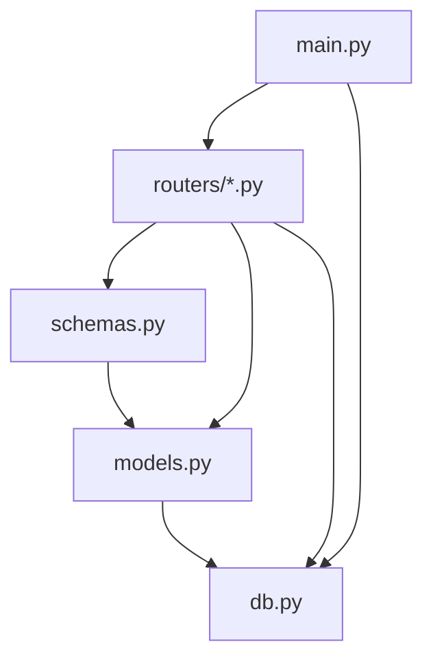
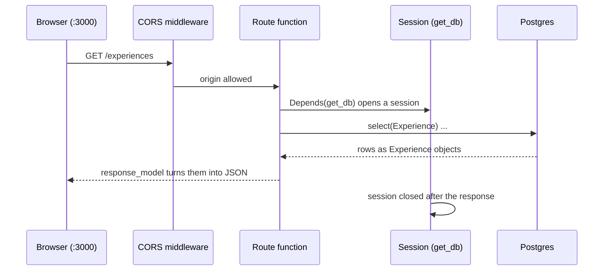

# Backend architecture

> Status: **draft**. Describes the code in [`backend/src/backend/`](../../../backend/src/backend/) as it is; update it in the PR that changes it.

## Contents

| Doc | What it answers |
|-----|-----------------|
| [`data-layer.md`](data-layer.md) | `db.py`, `models.py`, `schemas.py`: how data gets from Postgres to JSON, and why "schema" means two things |
| [`configuration.md`](configuration.md) | Settings, `.env`, environment variables, CORS |
| [`render-worker.md`](render-worker.md) | How LaTeX is compiled in production: the compile sandbox, its isolation, keeping it fast (design, not built) |

## Code layout

```
backend/
├── pyproject.toml        dependencies, managed with uv
├── .env.example          every setting, with local defaults (committed)
├── .env                  your copy (gitignored)
├── src/backend/
│   ├── main.py           the FastAPI app, middleware, /health, include_router
│   ├── routers/          one APIRouter per resource, e.g. templates.py
│   ├── db.py             settings, engine, declarative Base, get_db
│   ├── models.py         SQLAlchemy models: one class per table
│   ├── schemas.py        Pydantic models: shapes of jsonb columns and HTTP bodies
│   └── seed.py           loads the template gallery into the database
└── tests/                pytest
```

Imports only go downwards, so there are no cycles:



Routes live in one `APIRouter` per resource under `routers/`, mirroring the files in [`../endpoints/`](../endpoints/README.md): `endpoints/templates.md` is `routers/templates.py`. `main.py` only creates the app, adds middleware and includes each router.

**Add a resource:** create `routers/<resource>.py` with `router = APIRouter(prefix="/<resource>", tags=["<resource>"])`, write its routes with `@router.get(...)` (paths relative to the prefix), then add `app.include_router(<resource>.router)` in `main.py`. Its request and response bodies go in `schemas.py`.

## One request, end to end


