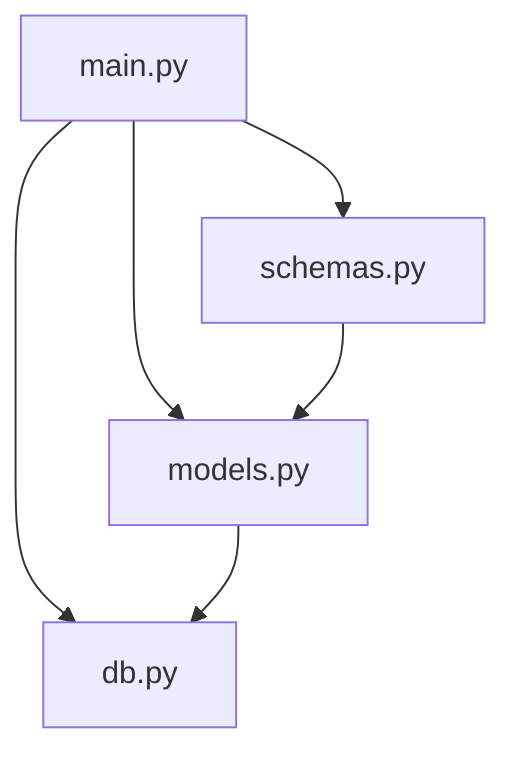
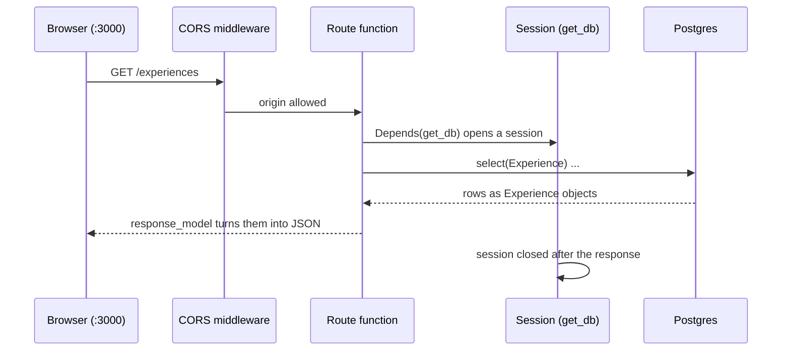

# Backend architecture

> Status: **draft**. Describes the code in [`backend/src/backend/`](../../../backend/src/backend/) as it is; update it in the PR that changes it.

## Contents

| Doc | What it answers |
|-----|-----------------|
| [`data-layer.md`](data-layer.md) | `db.py`, `models.py`, `schemas.py`: how data gets from Postgres to JSON, and why "schema" means two things |
| [`configuration.md`](configuration.md) | Settings, `.env`, environment variables, CORS |

## Code layout

```
backend/
├── pyproject.toml        dependencies, managed with uv
├── .env.example          every setting, with local defaults (committed)
├── .env                  your copy (gitignored)
├── src/backend/
│   ├── main.py           the FastAPI app, middleware and routes
│   ├── db.py             settings, engine, declarative Base, get_db
│   ├── models.py         SQLAlchemy models: one class per table
│   └── schemas.py        Pydantic models: shapes of jsonb columns and HTTP bodies
└── tests/                pytest
```

Imports only go downwards, so there are no cycles:



Once there are more than a handful of routes, they move out of `main.py` into one `APIRouter` per resource (e.g. `routers/experiences.py`), mirroring the files in [`../endpoints/`](../endpoints/README.md).

## One request, end to end


