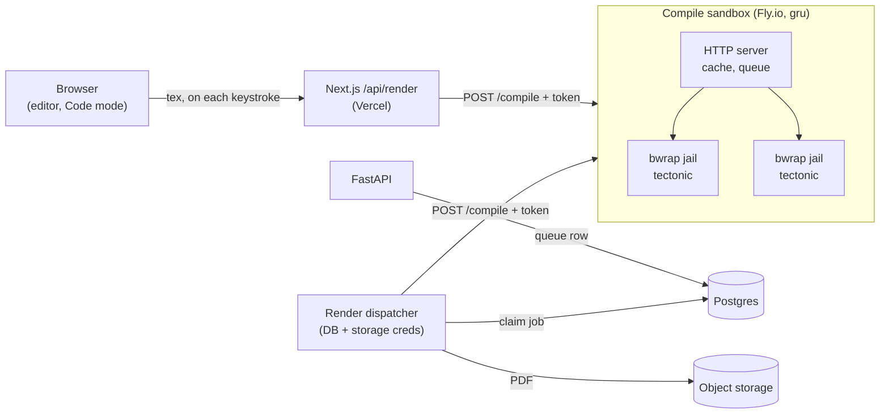

# Render worker

> Status: **design, not built**. Today `POST /api/render` ([`route.ts`](../../../frontend/app/api/render/route.ts)) compiles on the developer's machine and answers `404` outside `next dev`. This is the plan for compiling in production. Threats it answers: [`../../security/README.md`](../../security/README.md#1-latex-injection). Stored renders' contract: [`../endpoints/renders.md`](../endpoints/renders.md).

## Why it isn't just `/api/render` deployed

| Problem | Why it blocks production |
|---------|--------------------------|
| Raw LaTeX | Code mode sends LaTeX the user wrote. It can't be escaped, and Tectonic reads any file the process can see: `\input{../.env}` would print our secrets into the PDF |
| Infinite loops | `\def\x{\x}\x` holds a CPU until the timeout; a few at once take the host down |
| Vercel can't run it | No Tectonic binary in the runtime, and its package bundle (fonts, classes, hundreds of MB) would be fetched again on every cold start into an ephemeral `/tmp` |

## Shape

One small service, the **compile sandbox**, does nothing but turn LaTeX into a PDF. It holds no secrets, has no outbound network and can only be called by our own servers. Two callers use it:



- **Live preview** (the editor, Code mode): synchronous. The browser posts to `/api/render` as today, and in production that route forwards to the sandbox instead of running Tectonic locally. The target is the ~200 ms we measured locally, plus one network hop.
- **Stored renders** (downloads, the PDF a resume version keeps): asynchronous, exactly as [`renders.md`](../endpoints/renders.md) describes. The difference is in who compiles. The process that claims queued rows holds the database and storage credentials, so it must not run TeX. It becomes a **dispatcher** that calls the same sandbox and uploads what comes back.

The sandbox never sees a database URL, a storage key or a user id it could act on. Whatever a malicious document manages to read inside it, there is nothing there worth reading.

## Isolation, layer by layer

A container per compile (what [security](../../security/README.md#defence-2-compile-in-a-sandbox) first sketched) costs 300–800 ms to start, too slow for typing. The same guarantees come from layers that cost a few milliseconds per compile:

| Layer | What it is | Stops |
|-------|------------|-------|
| Machine | A Fly Machine is a Firecracker microVM with its own kernel | Escaping onto other tenants or our other services |
| No secrets | The service's environment holds only `COMPILE_TOKEN`; no DB, no storage, no API keys | Leaking anything through `\input{/proc/self/environ}` or a file read |
| No egress | Outbound network blocked; the bundle is baked into the image and Tectonic runs with `-C` (only cached) | Sending stolen data out, downloading payloads |
| Per-compile jail | Each compile runs under `bwrap` (bubblewrap) in fresh namespaces: only its own job directory (read-write) and the bundle (read-only) are visible; no network namespace; a new PID namespace | One user's compile reading another user's resume from a neighbouring job directory |
| Tectonic flags | `--untrusted` (shell escape and other known-insecure features off) | `\write18`, `-Z shell-escape` style escapes |
| Limits | `prlimit` per compile: 20 s CPU, 512 MB memory, 64 processes, 10 MB output; `timeout -s KILL 25` wall clock | Infinite loops, memory and fork bombs, huge PDFs |
| Non-root | The server and every jail run as an unprivileged user, `no-new-privileges` | Using a TeX bug to gain privileges |

The escaper in [`tex.ts`](../../../frontend/app/resumes/tex.ts) (and the backend's `tex_escape`) stays the main defence for text the app writes into LaTeX. For raw LaTeX from Code mode, the sandbox is the only defence, which is why the jail matters.

### One compile

```bash
# inside the sandbox, per request; $JOB is a fresh directory, or the session's warm one (below)
timeout -s KILL 25 prlimit --cpu=20 --as=536870912 --nproc=64 --fsize=10485760 \
  bwrap --unshare-all --die-with-parent --new-session \
        --ro-bind /usr /usr --ro-bind /lib /lib --ro-bind /etc/ssl /etc/ssl \
        --ro-bind /opt/tectonic /opt/tectonic \
        --bind "$JOB" /job --chdir /job \
        --tmpfs /tmp --proc /proc --dev /dev \
        --setenv HOME /job --setenv TECTONIC_CACHE_DIR /opt/tectonic/cache \
        /opt/tectonic/bin/tectonic -X compile main.tex --untrusted -C --keep-intermediates
```

`--unshare-all` includes the network namespace, so the jail has no network even if the machine's firewall were misconfigured.

## Keeping it fast

The local route got from ~260 ms to ~177 ms per new input, and ~3 ms for repeats, without changing a pixel (see the perf commit in [#16](https://github.com/PUCTech/rayume/pull/16)). All of that carries over:

| Technique | In the sandbox |
|-----------|----------------|
| Kept `.aux`, so Tectonic only reruns TeX when references change | A warm job directory per editing session: the route sends a `session` (an opaque id it derives from the resume and user, never shown to the sandbox as either). Directories expire after 10 idle minutes; each is only ever bound into that session's jails |
| Cache of recent inputs | In-memory LRU keyed by `sha256(template, tex, bundle digest)`. The key holds no user data, so two users sending the same text share a hit, which is harmless: same input, same PDF |
| One compile per session at a time | A queue per session; a newer request for a session replaces one still waiting (the editor already sends at most one in flight) |
| Bundle and formats ready | The image build compiles every template once, which fills the bundle and format caches. No first-request download, no 1 s format build |
| Close to users | Region `gru` (São Paulo). Pin the Vercel function to `gru1` too, so the hop between them is a few ms |

Latency budget for one keystroke, new input: browser → Vercel ~30 ms, Vercel → sandbox ~5 ms, compile ~180 ms (+ ~5 ms jail), back ~35 ms, draw ~60 ms. **About 0.3 s**, the same as the dev server today. Repeats skip the compile.

## API

`POST /compile` is the sandbox's only route, plus `GET /health`.

```http
POST /compile
Authorization: Bearer <COMPILE_TOKEN>
Content-Type: application/json

{ "template": "classic", "tex": "\\documentclass...", "body": null, "session": "b1946ac9..." }
```

| Field | Rules |
|-------|-------|
| `template` | One of the template files baked into the image, else `400` |
| `tex` | Up to 100,000 characters |
| `body` | Optional replacement `body.tex`, up to 100,000 characters |
| `session` | Optional, 16–64 hex characters; without it the compile gets a fresh directory |

| Response | When |
|----------|------|
| `200 application/pdf` | Compiled (or cached) |
| `422 text/plain` | LaTeX error: only Tectonic's `error: file.tex:LINE: message` lines, never the transcript (a transcript can echo file contents) |
| `413` / `429` | Input too large / the machine's compile slots are full |
| `401` | Missing or wrong token |

The token is shared by `/api/render` and the dispatcher only, stored as a secret in Vercel and Fly. `/api/render` stays the browser's only door, which keeps auth and rate limits in one place: per user, about 10 compiles a second, burst 20.

## Image

```dockerfile
FROM debian:bookworm-slim
RUN apt-get update && apt-get install -y --no-install-recommends bubblewrap util-linux ca-certificates curl \
 && useradd -m -u 10001 tex
# pinned release, checksum verified
ARG TECTONIC=0.17.0
RUN curl -fsSL "https://github.com/tectonic-typesetting/tectonic/releases/download/tectonic%40${TECTONIC}/tectonic-${TECTONIC}-x86_64-unknown-linux-musl.tar.gz" \
    | tar -xz -C /usr/local/bin tectonic
ENV TECTONIC_CACHE_DIR=/opt/tectonic/cache
COPY frontend/resumes /opt/tectonic/templates
# fill the bundle and format caches now: production runs offline with -C
RUN cd /opt/tectonic/templates && for f in classic modern jake awesome altacv moderncv; do tectonic -X compile $f.tex; done \
 && chown -R root:root /opt/tectonic && chmod -R a-w /opt/tectonic
COPY sandbox/ /srv/sandbox
USER tex
CMD ["/srv/sandbox/server"]
```

The server is a ~150-line HTTP program: check the token and input, look up the cache, queue per session, run the command above, return the PDF or the error lines. The language is open; Node can reuse the cache and queue code in `route.ts` as it stands.

Deploy: `fly.toml` with one `shared-cpu-2x` machine with 1 GB in `gru`, `min_machines_running = 1` (a cold machine adds ~1 s to the first keystroke), autoscale on concurrency. Block egress at the platform if it allows it; either way the jail's network namespace is the guarantee, and the image holds no credentials worth exfiltrating.

## Rollout

1. `sandbox/`: server, Dockerfile, `fly.toml`. Test locally with `docker run --network none`.
2. Security tests: every payload in the [attack table](../../security/README.md#1-latex-injection), sent as raw `tex`, must fail to read files (`\input{/etc/passwd}`, `\input{/proc/self/environ}`, a neighbouring job's `main.tex`) and stop within the limits. Run them in CI against the image.
3. `/api/render` in production: forward to `RENDER_WORKER_URL` with `COMPILE_TOKEN` when set; keep compiling locally under `next dev`.
4. The dispatcher for stored renders, when `POST /resumes/{id}/renders` is built.

## Open questions

- **Where the dispatcher lives:** a loop inside the FastAPI deployment, or its own small process. It needs the DB and storage, so not in the sandbox.
- **In-browser compiling** ([BusyTeX](https://texlyre.github.io/texlyre-busytex), WebAssembly) could take over the live preview later, with no server and nothing to attack. It's slower per compile and an alpha library; prototype it before choosing. The sandbox would still produce the stored PDF, the source of truth.
- **User namespaces on the target:** `bwrap` run by a non-root user needs unprivileged user namespaces. Firecracker machines usually allow them; check on the real machine before relying on it, or fall back to `nsjail` run with the capabilities it needs.
- **Vercel Sandbox** (per-use microVMs) instead of Fly: no machine to run, but a VM start per compile or session. Measure it against the latency budget.
