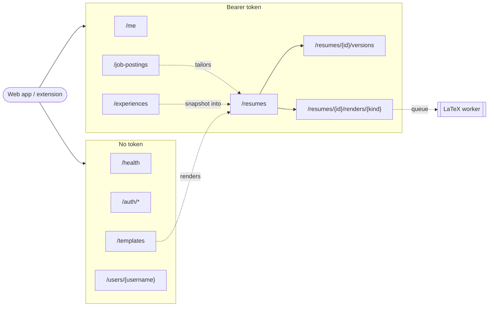

# API Endpoints

> Status: **draft**. Derived from the accepted schema in [`../../database/README.md`](../../database/README.md).
> FastAPI backend. Product context: [`../../PROJECT.md`](../../PROJECT.md).

One file per resource:

| File | Covers |
|------|--------|
| [`auth.md`](auth.md) | Register, login, refresh, logout, GitHub/Google OAuth |
| [`users.md`](users.md) | The signed-in user (`/me`), public profiles |
| [`experiences.md`](experiences.md) | Master Resume entries, AI refinement, ordering |
| [`job-postings.md`](job-postings.md) | Captured jobs, keyword extraction |
| [`resumes.md`](resumes.md) | Generated resumes, versions, restore, regenerate |
| [`renders.md`](renders.md) | PDF export and previews (async LaTeX) |
| [`templates.md`](templates.md) | Template gallery |

`GET /health` (already built) returns `200 {"ok": true}` and needs no auth.

## Route map

## All routes

| Method | Path | Auth | Summary |
|--------|------|------|---------|
| GET | `/health` | - | Liveness check |
| POST | `/auth/register` | - | Email signup |
| POST | `/auth/login` | - | Email login |
| POST | `/auth/refresh` | cookie | Rotate refresh token, new access token |
| POST | `/auth/logout` | cookie | Revoke the session's token family |
| GET | `/auth/{provider}` | - | Start GitHub/Google OAuth |
| GET | `/auth/{provider}/callback` | - | Finish OAuth |
| GET | `/me` | bearer | Own profile |
| PATCH | `/me` | bearer | Edit own profile |
| PUT | `/me/picture` | bearer | Upload profile picture |
| DELETE | `/me` | bearer | Disable own account |
| GET | `/users/{username}` | - | Public profile |
| GET | `/experiences` | bearer | List Master Resume entries |
| POST | `/experiences` | bearer | Create entry (AI refines it) |
| GET | `/experiences/{public_id}` | bearer | One entry |
| PATCH | `/experiences/{public_id}` | bearer | Edit entry |
| POST | `/experiences/{public_id}/refine` | bearer | Re-run AI on `raw_text` |
| DELETE | `/experiences/{public_id}` | bearer | Delete entry |
| PUT | `/experiences/order` | bearer | Reorder entries |
| GET | `/job-postings` | bearer | List saved jobs |
| POST | `/job-postings` | bearer | Save job (AI extracts keywords) |
| GET | `/job-postings/{public_id}` | bearer | One job |
| PATCH | `/job-postings/{public_id}` | bearer | Edit job |
| DELETE | `/job-postings/{public_id}` | bearer | Delete job |
| GET | `/resumes` | bearer | List resumes (current versions) |
| POST | `/resumes` | bearer | Generate a resume (AI) |
| GET | `/resumes/{public_id}` | bearer | Current version |
| PATCH | `/resumes/{public_id}` | bearer | Rename |
| DELETE | `/resumes/{public_id}` | bearer | Delete resume and all versions |
| GET | `/resumes/{public_id}/versions` | bearer | Version history |
| POST | `/resumes/{public_id}/versions` | bearer | Save an edit or template switch |
| GET | `/resumes/{public_id}/versions/{n}` | bearer | One old version |
| POST | `/resumes/{public_id}/versions/{n}/restore` | bearer | Copy an old version on top |
| POST | `/resumes/{public_id}/regenerate` | bearer | New AI version from the current Master Resume |
| POST | `/resumes/{public_id}/renders/{kind}` | bearer | Queue a PDF or preview |
| GET | `/resumes/{public_id}/renders/{kind}` | bearer | Render status and signed URL |
| GET | `/templates` | - | Gallery list and search |
| GET | `/templates/{slug}` | - | One template |

Not exposed: `logs`, `refresh_tokens` and `resume_renders` rows are never addressed by id (see the schema's "Public IDs").

## Conventions

- **JSON** in and out (`Content-Type: application/json`), except `PUT /me/picture` (multipart). Field names are `snake_case`, same as the columns.
- **IDs**: only `public_id` (12-char nanoid), `username` and template `slug` appear in paths and payloads. Internal `uuid`s never leave the backend. Foreign keys in payloads are public ids too (`job_posting_id` means the posting's `public_id`, `template` means the slug).
- **Timestamps**: ISO 8601 with offset, UTC (`2026-11-06T18:25:00Z`).
- **Auth**: `Authorization: Bearer <access_token>` on every "bearer" route. The refresh token travels only in an `HttpOnly` cookie (see [`auth.md`](auth.md)).
- **Ownership**: every query filters by the user from the token. Someone else's resource returns **404**, not 403, so ids can't be probed.
- **PATCH** is partial: omitted fields are left unchanged; sending `null` clears a nullable field.
- **Lists** are not paginated. A user's experiences, jobs and resumes are small. shortcut: no pagination, add `?limit`/`?cursor` when a list gets past a few hundred rows.
- **AI calls** (refine, keyword extraction, generate, regenerate) are synchronous: the request waits for the model and returns the result. Each one writes an `ai.call` log row.

## Errors

FastAPI's default shape: `{"detail": "<message>"}`, or a list of field errors for 422.

| Status | When |
|--------|------|
| 400 | Request is well-formed but not allowed (e.g. reordering with ids that don't match the user's list) |
| 401 | Missing, expired or invalid access token; failed login; invalid refresh token |
| 404 | Resource doesn't exist or isn't yours |
| 409 | Unique conflict (email, username) or concurrent version save after retries |
| 413 | Upload too large |
| 422 | Body or query fails validation |
| 429 | Rate limit hit (auth and AI routes) |
| 502 | The LLM provider failed or returned output that doesn't fit the schema |
