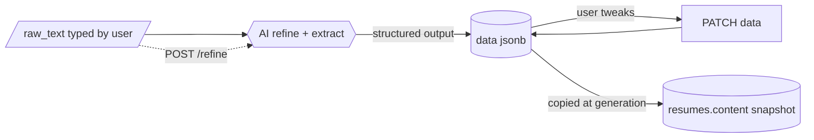

# Experiences

Table: `experiences`. The Master Resume entries. Always the live, editable state; history lives in resume snapshots.

## Experience object

```json
{
  "public_id": "k3Jd9Qp0Lm2a",
  "type": "professional",
  "raw_text": "Worked at Acme on the payments API, cut latency by half...",
  "data": {
    "title": "Backend Developer",
    "organization": "Acme",
    "start": "2024-03",
    "end": null,
    "location": "São Paulo, BR",
    "bullets": ["Cut payments API p95 latency by 50% by ..."],
    "hard_skills": ["Python", "PostgreSQL"],
    "soft_skills": ["Cross-team communication"]
  },
  "position": 0,
  "created_at": "2026-11-06T18:25:00Z",
  "updated_at": "2026-11-06T18:25:00Z"
}
```

- `type`: `professional | education | project | certification | volunteering`.
- `data` follows the backend's Pydantic schema. `start` / `end` are `YYYY-MM`; `end: null` means current. Templates render from `data`, never `raw_text`.



### GET /experiences

| Param | In | Rules |
|-------|----|-------|
| `type` | query | optional, filter by one type |

- `200` `[Experience]` ordered by `position`.

### POST /experiences

Creates an entry and runs the AI refine call on it (synchronous).

| Body field | Type | Rules |
|------------|------|-------|
| `type` | string | required, one of the enum |
| `raw_text` | string | required, 1 to 5000 chars |

- `201` Experience. `position` = end of the list. Logs `ai.call`.
- `422` validation. `429` AI rate limit.
- `502` AI failed: nothing is saved, the client can retry.

### GET /experiences/{public_id}

- `200` Experience. `404` unknown or not yours.

### PATCH /experiences/{public_id}

Manual edit. Does **not** call the AI; use `/refine` for that.

| Body field | Type | Rules |
|------------|------|-------|
| `type` | string | optional |
| `raw_text` | string | optional, 1 to 5000 |
| `data` | object | optional, full replacement, validated against the schema |

- `200` Experience. Logs `experience.updated`.
- `404`, `422`.

### POST /experiences/{public_id}/refine

Re-runs the AI on the current `raw_text` and replaces `data`. No body.

- `200` Experience. Logs `ai.call` and `experience.updated`.
- `404`, `429`, `502` (on failure `data` is unchanged).

### DELETE /experiences/{public_id}

- `204`. Hard delete; saved resume versions keep their copy. The remaining `position`s are not renumbered (gaps are fine, order is still correct).
- `404`.

### PUT /experiences/order

Sets the whole order at once (drag and drop).

| Body field | Type | Rules |
|------------|------|-------|
| `ids` | string[] | required, every `public_id` of the user's experiences, each once, in the new order |

- `200` `[Experience]` in the new order; `position` = index in `ids`.
- `400` `ids` is not exactly the user's set (missing, extra, duplicate or foreign ids).
