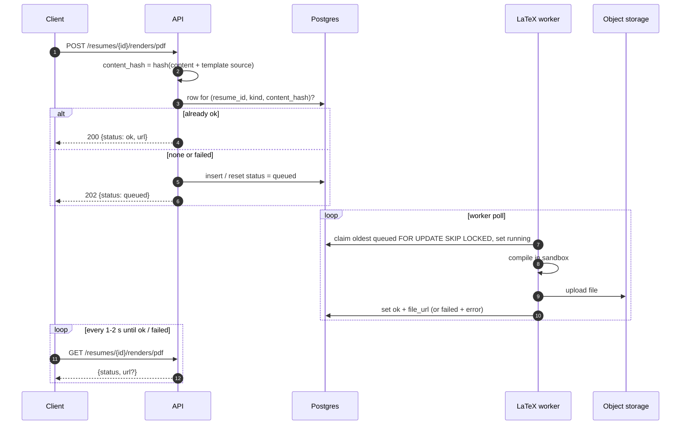
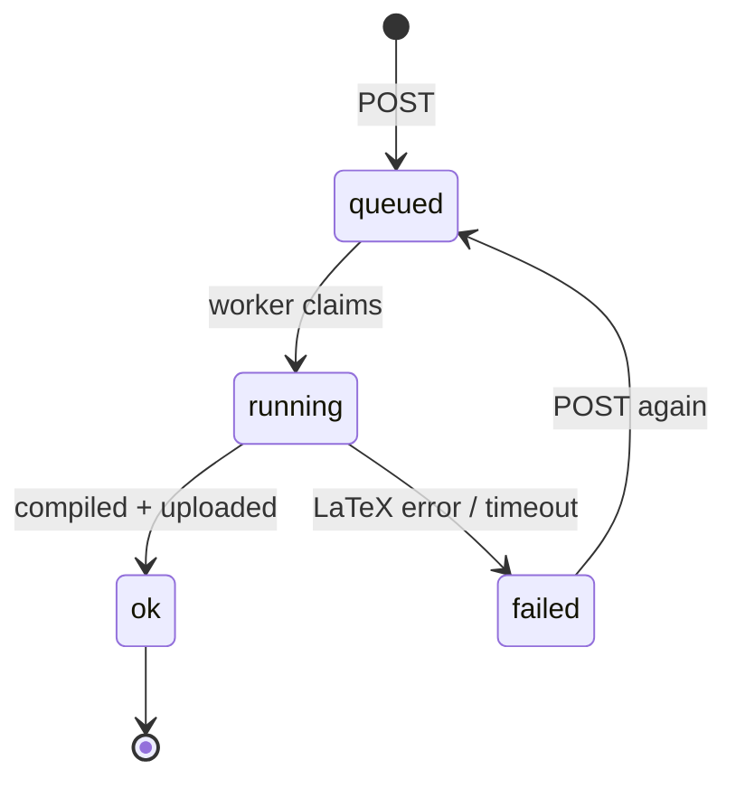

# Renders (PDF and previews)

Table: `resume_renders`. LaTeX can't run on the API host, so compilation is asynchronous: the API queues a row, a separate worker (Docker + TeX Live) compiles it. Render rows have no public id; the API addresses them by **resume + version + kind (+ template)**.





## Render object

```json
{
  "kind": "pdf",
  "version": 3,
  "template": "classic-ats",
  "status": "ok",
  "url": "https://storage.../signed?expires=...",
  "error": null,
  "queued_at": "2026-11-06T18:25:00Z",
  "updated_at": "2026-11-06T18:25:04Z"
}
```

- `status`: `queued | running | ok | failed`.
- `url` is a fresh short-lived signed URL, only when `ok`. `file_url` (the storage path) is never returned.
- `error` is a short, user-safe message when `failed`. The full compile log stays in the DB.

## Params shared by both routes

| Param | In | Type | Rules |
|-------|----|------|-------|
| `public_id` | path | string | resume |
| `kind` | path | string | `pdf` or `preview`, else 404 |
| `version` | query | int | optional, default the current version |
| `template` | query | string | optional slug, **`preview` only**: render this version's content with another template (the live preview gallery). Default the version's own template |

### POST /resumes/{public_id}/renders/{kind}

Queues a compile, or returns the existing one for identical input. No body.

- `202` Render with `status: queued` (new row, or a `failed` row reset to `queued`).
- `200` Render already `queued`, `running` or `ok` for this exact input: nothing new is queued.
- `400` `template` sent with `kind = pdf`.
- `404` resume, version or template.
- `429` too many queued renders for this user.

Gallery: the frontend calls `POST .../renders/preview?template=<slug>` once per template, then polls each.

### GET /resumes/{public_id}/renders/{kind}

Same params. Returns the latest render for the input.

- `200` Render.
- `404` nothing was queued for this input yet (or unknown resume/version/template).

## Schema gap

A row only knows `resume_id` (a version), `kind` and `content_hash`. For a gallery preview with **another** template, the worker can't tell which template to compile, and `GET` can't find the row without recomputing the hash. Add `resume_renders.template_id` (FK, `on delete cascade`) to the schema before building the gallery.
