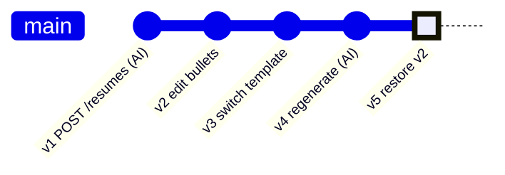

# Resumes

Table: `resumes`. Each row is one **version**; all versions of a resume share its `public_id`. The current version is the highest `version`. `content` and the template are never changed after insert: every change inserts a new row.

## Resume object

```json
{
  "public_id": "R7tYu1Io9Pa0",
  "version": 3,
  "title": "Acme backend application",
  "template": "classic-ats",
  "job_posting_id": "Pq8sN2xTb4Ze",
  "content": { "...": "ResumeContent, below" },
  "created_at": "2026-11-06T18:25:00Z",
  "updated_at": "2026-11-06T18:25:00Z"
}
```

- `template` is the template's `slug`; `job_posting_id` is the posting's `public_id` (null for a generic resume, or when the posting was deleted).
- `created_at` is when **this version** was made.

`ResumeContent` is the complete snapshot, validated by a Pydantic schema in the backend:

```json
{
  "profile": {
    "name": "Raul Kolaric",
    "profession": "Backend Developer",
    "summary": "Tailored summary",
    "email": "raul@example.com",
    "phone": "+55 11 99999-0000",
    "address": "São Paulo, BR",
    "links": [{ "label": "GitHub", "url": "https://github.com/raulkolaric" }]
  },
  "entries": [
    { "type": "professional", "title": "...", "organization": "...", "start": "2024-03", "end": null,
      "location": "...", "bullets": ["..."], "hard_skills": ["..."], "soft_skills": ["..."] }
  ]
}
```

`VersionSummary` (history list, no `content`): `{ "version", "template", "created_at" }`.

## How versions grow

Each operation below adds one commit-like row; nothing is rewritten.



`v5` is a copy of `v2`'s `content` and template; `v3` and `v4` stay in the history.

### GET /resumes

| Param | In | Rules |
|-------|----|-------|
| `job_posting_id` | query | optional, only resumes tailored to this posting |

- `200` `[Resume]` without `content`: the latest row per `public_id`, newest `updated_at` first.

### POST /resumes

Generates version 1 with the AI from the current Master Resume (synchronous).

| Body field | Type | Rules |
|------------|------|-------|
| `title` | string | required, 1 to 200 |
| `template` | string | required, existing template slug |
| `job_posting_id` | string \| null | optional; when set, the AI tailors to it (keywords, summary, entry choice) |
| `experience_ids` | string[] | optional, restrict to these experiences; default: the AI picks from all |

Flow: load user + experiences (+ job posting) → AI tailor/map call → validate as `ResumeContent` → insert `version = 1`.

- `201` Resume. Logs `ai.call` and `resume.version_created`.
- `404` template, job posting or an experience id not found (or not yours).
- `400` the user has no experiences.
- `422`, `429`, `502` (nothing saved).

### GET /resumes/{public_id}

- `200` Resume, current version, with `content`. `404`.

### PATCH /resumes/{public_id}

Rename only. Updates `title` on **every** version row; no new version.

| Body field | Type | Rules |
|------------|------|-------|
| `title` | string | required, 1 to 200 |

- `200` Resume (current version). `404`, `422`.

### DELETE /resumes/{public_id}

- `204`. Deletes every version and, by cascade, their renders. Stored files are cleaned up by a job.
- `404`.

## Versions

### GET /resumes/{public_id}/versions

- `200` `[VersionSummary]`, newest first. `404`.

### POST /resumes/{public_id}/versions

Saves a user edit and/or a template switch as a new version. No AI call.

| Body field | Type | Rules |
|------------|------|-------|
| `base_version` | int | required, the version the client edited from |
| `content` | ResumeContent | optional, default: copy the current one |
| `template` | string | optional slug, default: keep the current one |

At least one of `content` / `template` must be sent.

- `201` Resume (`version = current + 1`, `title` and `job_posting_id` copied). Logs `resume.version_created`.
- `409` `base_version` is no longer the current version (someone saved in between, e.g. another tab). The client reloads instead of overwriting. Concurrent inserts racing on `unique (public_id, version)` are retried by the backend first.
- `404` resume or template. `400` neither field sent. `422` invalid `content`.

### GET /resumes/{public_id}/versions/{n}

| Param | In | Rules |
|-------|----|-------|
| `n` | path | int ≥ 1 |

- `200` Resume at version `n`, with `content`. `404`.

### POST /resumes/{public_id}/versions/{n}/restore

Copies version `n`'s `content` and template into a new version. No body.

- `201` Resume (new current version). `404`.

### POST /resumes/{public_id}/regenerate

Runs the AI again from the **current** Master Resume and the linked job posting (if it still exists), with the current template.

| Body field | Type | Rules |
|------------|------|-------|
| `experience_ids` | string[] | optional, same as on create |

- `201` Resume (new version). Logs `ai.call` and `resume.version_created`.
- `404`, `429`, `502` (nothing saved).
