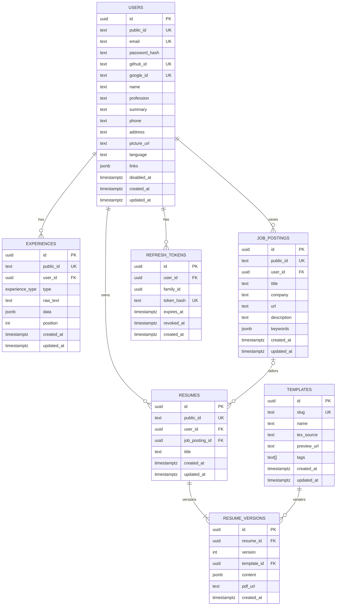

# Database Schema (final)

> Status: **accepted**. Merged from the proposals in [`sketch/`](sketch/) (Raul, Thierry, Lorenzo).
> PostgreSQL via SQLAlchemy 2 + psycopg 3. Product context: [`../PROJECT.md`](../PROJECT.md).
> The original instructions for the proposal round are archived in [`sketch/README.md`](sketch/README.md).

## Sources

| Part | Taken from |
|------|------------|
| Base tables (`users`, `experiences`, `resumes`, `templates`) | Raul |
| `updated_at` columns, `refresh_tokens.family_id`, JWT validation rules, complete resume snapshots | Thierry |
| `job_postings` table (+ `resumes.job_posting_id`) | Lorenzo, with `timestamptz` timestamps added |
| `public_id`, `users.disabled_at`, `resume_versions` | New team requirements |

## Conventions

- `snake_case` plural table names, English identifiers.
- Primary keys are `uuid` and **never leave the backend**. Rows the API addresses directly have a `public_id` (see below).
- **Every timestamp is `timestamptz`.** No `timestamp` without time zone, no `date` for audit columns.
- `created_at timestamptz not null default now()` on every table. `updated_at timestamptz not null default now()` on every mutable table, set by the backend on each update (SQLAlchemy `onupdate=func.now()`).

## Diagram

`experience_type` enum: `professional | education | project | certification | volunteering`

Result: 7 tables. That is above the "about 2 to 5" guideline from the proposal round; the two extra tables come from in-scope features (job tailoring) and the new versioning requirement.

## Public IDs

`users`, `experiences`, `job_postings` and `resumes` have `public_id text not null unique`: a short random id (e.g. a 12-character nanoid) generated by the backend on insert. It is what appears in URLs and API payloads (`/resumes/V1StGXR8_Z5j`). The `uuid` PK stays internal and is used for foreign keys and joins.

- `templates` don't need one: `slug` already is their stable public identifier.
- `resume_versions` are addressed as `(resume public_id, version)`, e.g. `/resumes/V1StGXR8_Z5j/versions/3`.
- `refresh_tokens` are never exposed.

## Auth: in-house JWT

The directors asked us to implement JWT auth ourselves (for learning), so there is no auth library and no third-party auth tables. This section follows Thierry's proposal.

### Access token
- Short-lived JWT (about 15 min), signed by the backend and **never stored** in the DB.
- On every protected request the backend must:
  - verify the signature with a trusted key and an **explicitly allowed algorithm** (never accept `alg` from the token header blindly, never `none`);
  - require and validate `exp`, `iss` (our issuer) and `aud` (this API); validate `nbf` when present;
  - require `sub` (the user's `public_id`) to match an existing user **with `disabled_at IS NULL`**;
  - check that this user may access the requested resource (every query filters by the user from the token).
- Use a maintained JWT library for the cryptography (e.g. PyJWT); we implement the flow, not the crypto.
- The payload is readable by anyone, so it never contains passwords or secrets.

### Refresh token
- Long-lived random string. Only its SHA-256 **hash** is stored in `refresh_tokens.token_hash`; the raw value is only sent to the client.
- **Families**: every login starts a new `family_id`. Each refresh revokes the current row and inserts its replacement with the same `family_id`, in one transaction. Only one refresh can consume a given token.
- **Reuse detection**: if an already-rotated (revoked) token is presented, reject it and revoke every active token in that family. Other families (other devices) are unaffected.
- **Fixed deadline**: 30 days from the original login. Replacements inherit the family's `expires_at`; rotation does not extend it.
- A token is valid when `revoked_at IS NULL AND expires_at > now()`. Revoked rows are kept until the family expires so reuse can be detected; deleting expired rows is a cleanup job.
- Logout sets `revoked_at` on the family. Revoking a refresh token stops renewal; an access JWT already issued stays valid until its `exp`.

### Logins
- **Email/password**: hashed with argon2 (or bcrypt) into `users.password_hash`. Never store plain passwords.
- **GitHub/Google**: the backend runs the OAuth flow, matches the provider's user id to `github_id` / `google_id`, then issues our own tokens.

## Tables

### users
The Master Resume owner. One row per person.
- `email` is unique. `password_hash` is null for OAuth-only users.
- `github_id` / `google_id`: the provider's user id, unique and nullable. Columns instead of an `accounts` table, since there are two fixed providers.
- `phone` is **text** (keeps the leading `+` and zeros). `summary` is the "about me" text, not an experience.
- `language` is the UI preference: `en` | `pt-BR`.
- `links` is a JSON array: `[{ "label": "GitHub", "url": "https://..." }]`.
- `picture_url` points to object storage; files never go in the DB.
- No `age` column, on purpose (risk of age discrimination).
- **`disabled_at` (soft delete)**: null means active. Disabling a user sets it to `now()` and revokes all their refresh tokens in the same transaction. Their rows stay in place (nothing is cascaded or deleted), login and JWT validation reject them, and reactivating means setting it back to null. A timestamp instead of a boolean, so we also know *when* it happened.
  - `email`, `github_id` and `google_id` stay unique while disabled, so a disabled user can't sign up again with the same email; they must be reactivated. A hard delete (e.g. a LGPD erasure request) is a separate, explicit operation.

### experiences
Every entry of the Master Resume: jobs, education, projects, certifications, volunteering.
- `raw_text` is what the user typed, kept as is.
- `data` is the AI's **structured output**, validated by a Pydantic schema in the backend (title, organization, start/end, location, bullets, hard_skills, soft_skills). Templates render from `data`, never from `raw_text`.
- `position` sets the order within a user's list.
- Experiences are always the live, editable state. Their history lives in the resume snapshots (`resume_versions.content`), not here.

### job_postings
A job captured by the browser extension or pasted in the app (feature 3, job tailoring). From Lorenzo's proposal, with `created_at` / `updated_at` added.
- `title`, `company` and `url` are what the extension captures; `url` is nullable for pasted jobs.
- `description` is the raw job text; `keywords` is the AI-extracted list (jsonb array of strings) used for tailoring.
- One posting can be used by several resumes. Replaces Raul's `resumes.job_description` column.

### resumes
A generated resume, as the user sees it in their list. It holds what stays the same across versions; the content itself lives in `resume_versions`.
- `title` is the user-facing name ("Backend @ Nubank").
- `job_posting_id` is the job it's tailored to; null for a generic resume. `on delete set null`, so deleting a posting doesn't delete resumes.
- `updated_at` is bumped whenever a new version is added, so the list can sort by "last edited".

### resume_versions
Every saved state of a resume. **Old versions are kept** and never edited.
- `version` is an `int` starting at 1, with a unique index on `(resume_id, version)`. The **current** version is the highest number (`ORDER BY version DESC LIMIT 1`).
  - Why an int and not an `is_main boolean`: the int also gives the order of the history, and adding a version is a single insert. A boolean needs two rows updated together and a partial unique index to guarantee exactly one main version.
- Each change (AI regeneration, user edit, template switch) inserts a new row with `version = current + 1`. Restoring an old version copies it into a new row, so history is never rewritten.
- `content` is a **complete, independent snapshot** (Thierry): name, contact details and the tailored entries as they were when the version was made. Rendering it never pulls newer data from `users` or `experiences`, so editing the Master Resume never changes a saved version.
- `template_id` is per version, so switching templates is a new version and the old one still renders as it was. Rendering an existing `content` with another template doesn't need a new AI call.
- `pdf_url` points to the compiled PDF in object storage; null until it's compiled.
- No `updated_at`: versions are immutable.

### templates
The LaTeX template gallery, written by the team (not uploaded by users).
- `slug` is the stable public identifier. `tags` power the gallery search.
- `tex_source` holds the LaTeX source; `preview_url` points to the preview image in object storage.
- Templates aren't versioned: fixing a template affects every version that uses it. If that becomes a problem, add a `template_versions` table later.

### refresh_tokens
One row per issued refresh token; one `family_id` per login session (device). See the auth section.
- `family_id` is `uuid not null` and indexed.
- No `updated_at`: the only change is setting `revoked_at`.

## Indexes and constraints

Beyond PKs and the `UK` columns in the diagram:
- Index every FK: `experiences.user_id`, `job_postings.user_id`, `resumes.user_id`, `resumes.job_posting_id`, `resume_versions.template_id`, `refresh_tokens.user_id`, `refresh_tokens.family_id`.
- `unique (resume_id, version)` on `resume_versions` (also serves lookups by resume).
- FKs to `users` use `on delete cascade`; that only fires on a hard delete, since soft delete never removes the row.
- `resume_versions.template_id` uses `on delete restrict`: a template in use can't be deleted.

## Not in this schema

- **Lorenzo's `entries` columns, `resume_renders`, `resumes.locale`, `templates.schema` / `locales`**: not taken in this round. `resume_renders` is the first thing to add if PDF compilation becomes asynchronous.
- **Experience history**: the Master Resume keeps only its current state; history is captured by resume snapshots.
- **Template versioning**: see `templates`.
- **Sessions table**: access JWTs are stateless; `refresh_tokens` covers sessions.
- **Logs**: they go to application logging, not the DB.
- Future (non-MVP) features such as scoring, job alerts or billing get no tables until they're in scope.
