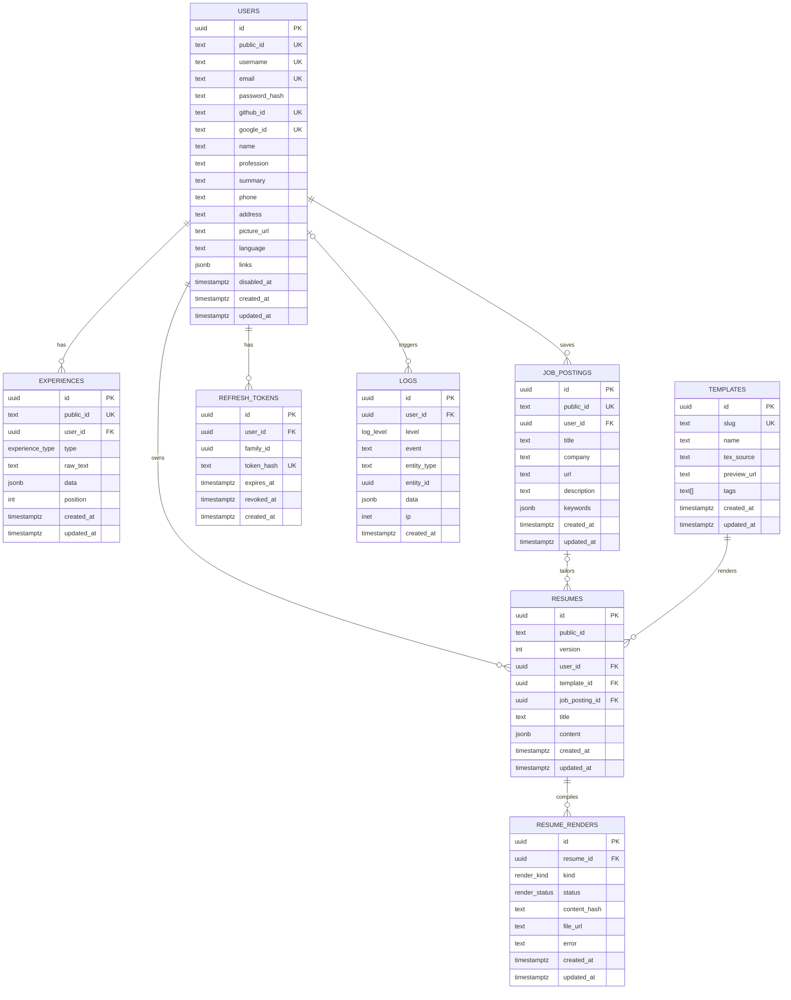

# Database Schema (final)

> Status: **accepted**. Merged from the proposals in [`sketch/`](sketch/) (Raul, Thierry, Lorenzo).
> PostgreSQL via SQLAlchemy 2 + psycopg 3. Product context: [`../PROJECT.md`](../PROJECT.md).
> The original instructions for the proposal round are archived in [`sketch/README.md`](sketch/README.md).

## Sources

| Part | Taken from |
|------|------------|
| Base tables (`users`, `experiences`, `resumes`, `templates`) | Raul |
| `updated_at` columns, `refresh_tokens.family_id`, JWT validation rules, complete resume snapshots | Thierry |
| `job_postings` and `resume_renders` tables | Lorenzo, with `timestamptz` timestamps added |
| `public_id`, `users.disabled_at`, resume versioning, `logs` | New team requirements |

## Conventions

- `snake_case` plural table names, English identifiers.
- Primary keys are `uuid` and **never leave the backend**. Rows the API addresses directly have a `public_id` (see below).
- **Every timestamp is `timestamptz`.** No `timestamp` without time zone, no `date` for audit columns.
- `created_at timestamptz not null default now()` on every table. `updated_at timestamptz not null default now()` on every mutable table, set by the backend on each update (SQLAlchemy `onupdate=func.now()`).

## Diagram

Enums:
- `experience_type`: `professional | education | project | certification | volunteering`
- `render_kind`: `pdf | preview`
- `render_status`: `queued | running | ok | failed`
- `log_level`: `info | warning | error`

Result: 8 tables. That is above the "about 2 to 5" guideline from the proposal round; the extra tables come from in-scope features (job tailoring, async LaTeX compilation) and the logging requirement.

## Public IDs

`users`, `experiences`, `job_postings` and `resumes` have a `public_id text not null`: a short random id (e.g. a 12-character nanoid) generated by the backend. It is what appears in URLs and API payloads (`/resumes/V1StGXR8_Z5j`). The `uuid` PK stays internal and is used for foreign keys and joins.

- It is `unique` on `users`, `experiences` and `job_postings`. On `resumes` it is shared by all versions of one resume, so the unique key there is `(public_id, version)` (see `resumes`).
- `users` also have a `username` for readable profile URLs (`/u/raulkolaric`). `public_id` stays the stable id (JWT `sub`, API payloads), because a username can change.
- `templates` don't need one: `slug` already is their stable public identifier.
- `resume_renders`, `refresh_tokens` and `logs` are never addressed directly by the API.

## Auth: in-house JWT

The directors asked us to implement JWT auth ourselves (for learning), so there is no auth library and no third-party auth tables. This section follows Thierry's proposal.

### Access token
- Short-lived JWT (about 15 min), signed by the backend and **never stored** in the DB.
- On every protected request the backend must:
  - verify the signature with a trusted key and an **explicitly allowed algorithm** (never accept `alg` from the token header blindly, never `none`);
  - require and validate `exp`, `iss` (our issuer) and `aud` (this API); validate `nbf` when present;
  - require `sub` (the user's `public_id`) to match an existing user **with `disabled_at IS NULL`**;
  - check that this user may access the requested resource (every query filters by the user from the token).
- Use a maintained JWT library for the cryptography (e.g. PyJWT); we implement the flow, not the crypto.
- The payload is readable by anyone, so it never contains passwords or secrets.

### Refresh token
- Long-lived random string. Only its SHA-256 **hash** is stored in `refresh_tokens.token_hash`; the raw value is only sent to the client.
- **Families**: every login starts a new `family_id`. Each refresh revokes the current row and inserts its replacement with the same `family_id`, in one transaction. Only one refresh can consume a given token.
- **Reuse detection**: if an already-rotated (revoked) token is presented, reject it and revoke every active token in that family. Other families (other devices) are unaffected.
- **Fixed deadline**: 30 days from the original login. Replacements inherit the family's `expires_at`; rotation does not extend it.
- A token is valid when `revoked_at IS NULL AND expires_at > now()`. Revoked rows are kept until the family expires so reuse can be detected; deleting expired rows is a cleanup job.
- Logout sets `revoked_at` on the family. Revoking a refresh token stops renewal; an access JWT already issued stays valid until its `exp`.

### Logins
- **Email/password**: hashed with argon2 (or bcrypt) into `users.password_hash`. Never store plain passwords.
- **GitHub/Google**: the backend runs the OAuth flow, matches the provider's user id to `github_id` / `google_id`, then issues our own tokens.

## Tables

### users
The Master Resume owner. One row per person.
- `email` is unique. `password_hash` is null for OAuth-only users.
- **`username`** (`text not null`) gives clean URLs (`/u/raulkolaric`).
  - Unique **case-insensitively**: `unique index on lower(username)`, and the backend stores it lowercased.
  - Validated in the backend: 3 to 30 characters, `^[a-z0-9_-]+$`, not in a reserved list (`api`, `admin`, `login`, `settings`, ...) so it can't collide with app routes.
  - Email signups choose it; OAuth signups get a suggestion (GitHub login, or the email's local part) with a number added on collision, which the user can change later.
  - Changing it breaks old profile links; we don't keep redirects for the MVP. A disabled user keeps their username, like their email.
- `github_id` / `google_id`: the provider's user id, unique and nullable. Columns instead of an `accounts` table, since there are two fixed providers.
- `phone` is **text** (keeps the leading `+` and zeros). `summary` is the "about me" text, not an experience.
- `language` is the UI preference: `en` | `pt-BR`.
- `links` is a JSON array: `[{ "label": "GitHub", "url": "https://..." }]`.
- `picture_url` points to object storage; files never go in the DB.
- No `age` column, on purpose (risk of age discrimination).
- **`disabled_at` (soft delete)**: null means active. Disabling a user sets it to `now()` and revokes all their refresh tokens in the same transaction. Their rows stay in place (nothing is cascaded or deleted), login and JWT validation reject them, and reactivating means setting it back to null. A timestamp instead of a boolean, so we also know *when* it happened.
  - `email`, `github_id` and `google_id` stay unique while disabled, so a disabled user can't sign up again with the same email; they must be reactivated. A hard delete (e.g. a LGPD erasure request) is a separate, explicit operation.

### experiences
Every entry of the Master Resume: jobs, education, projects, certifications, volunteering.
- `raw_text` is what the user typed, kept as is.
- `data` is the AI's **structured output**, validated by a Pydantic schema in the backend (title, organization, start/end, location, bullets, hard_skills, soft_skills). Templates render from `data`, never from `raw_text`.
- `position` sets the order within a user's list.
- Experiences are always the live, editable state. Their history lives in the resume snapshots (`resumes.content`), not here.

### job_postings
A job captured by the browser extension or pasted in the app (feature 3, job tailoring). From Lorenzo's proposal, with `created_at` / `updated_at` added.
- `title`, `company` and `url` are what the extension captures; `url` is nullable for pasted jobs.
- `description` is the raw job text; `keywords` is the AI-extracted list (jsonb array of strings) used for tailoring.
- One posting can be used by several resumes. Replaces Raul's `resumes.job_description` column.

### resumes
A generated resume. **Each row is one version**; old versions are kept.
- **Versioning**: all versions of one resume share the same `public_id`. `version` is an `int` starting at 1, with `unique (public_id, version)`. The **current** version is the highest number (`ORDER BY version DESC LIMIT 1`).
  - `/resumes/{public_id}` returns the current version; `/resumes/{public_id}/versions/{n}` returns an old one; the user's resume list is the latest row per `public_id`.
  - Why an int and not an `is_main boolean`: the int also gives the order of the history, and adding a version is a single insert. A boolean needs two rows updated together and a partial unique index to guarantee exactly one main version.
- Each change (AI regeneration, user edit, template switch) inserts a new row with `version = current + 1`, copying `title` and `job_posting_id`. Restoring an old version copies it into a new row, so history is never rewritten.
  - Two concurrent saves can compute the same `version`; the unique key makes one fail and the backend retries.
- `content` is a **complete, independent snapshot** (Thierry): name, contact details and the tailored entries as they were when the version was made. Rendering it never pulls newer data from `users` or `experiences`, so editing the Master Resume never changes a saved version.
- `content` and `template_id` are never updated after insert. `title` is the one exception: renaming updates it on every row of that `public_id`, which is what `updated_at` tracks.
- `template_id` is per version, so the old version still renders as it was after a template switch. Rendering an existing `content` with another template doesn't need a new AI call.
- `job_posting_id` is the job it's tailored to; null for a generic resume. `on delete set null`, so deleting a posting doesn't delete resumes.
- No `pdf_url`: compiled files live in `resume_renders`.

### resume_renders
One row per LaTeX compilation of a resume version (the PDF export or a gallery preview). From Lorenzo's proposal, with `timestamptz` timestamps added. Replaces Raul's `resumes.pdf_url`.
- Compilation is **asynchronous**: LaTeX can't run on a serverless host, so a separate dispatcher does it. The API inserts a row with `status = queued`; the dispatcher claims it (`FOR UPDATE SKIP LOCKED`), has the compile sandbox (Tectonic) compile it, uploads the file and sets `ok` or `failed`. See [`../backend/architecture/render-worker.md`](../backend/architecture/render-worker.md).
- `kind = preview` rows feed the live preview gallery (page 1 as an image); `kind = pdf` rows are the exports.
- `content_hash` (hash of `content` + template source) avoids recompiling identical input: `unique (resume_id, kind, content_hash)`.
- `file_url` is the path in object storage (private bucket, served through short-lived signed URLs); null until `ok`.
- `error` holds the failure message and the compile log when `status = failed`.
- `created_at` is when it was queued; `updated_at` changes with each status change, so `updated_at - created_at` on an `ok` row is the compile time.

### templates
The LaTeX template gallery, written by the team (not uploaded by users).
- `slug` is the stable public identifier. `tags` power the gallery search.
- `tex_source` holds the LaTeX source; `preview_url` points to the preview image in object storage.
- Templates aren't versioned: fixing a template affects every resume that uses it. If that becomes a problem, add a `template_versions` table later.

### refresh_tokens
One row per issued refresh token; one `family_id` per login session (device). See the auth section.
- `family_id` is `uuid not null` and indexed.
- No `updated_at`: the only change is setting `revoked_at`.

### logs
An append-only record of what happened in the app: security events, user actions and AI calls. Rows are never updated, so there is no `updated_at`.
- `user_id` is who did it; null for anonymous events (e.g. a failed login for an unknown email). `on delete set null`, so logs survive a hard delete of the user.
- `level` is `info | warning | error`.
- `event` is a dotted name defined in one backend module, e.g.:
  - auth: `auth.login`, `auth.login_failed`, `auth.logout`, `auth.refresh_reuse_detected`, `user.disabled`, `user.reactivated`;
  - data: `resume.version_created`, `job_posting.created`, `experience.updated`;
  - AI and rendering: `ai.call` (model, tokens, latency, success), `render.failed`.
- `entity_type` + `entity_id` point to the row the event is about (e.g. `resume` + its `id`). No FK, since it can point to any table and must outlive deleted rows.
- `data` holds event-specific details as JSON.
- `ip` is the client IP (`inet`), for security events.
- **Never log** passwords, tokens (raw or hashed), JWTs, or resume / job content. Log ids and metadata only; logs are read far more widely than user data.
- Retention: delete rows older than a fixed period (e.g. 90 days) in a cleanup job. Debug output and stack traces still go to application logging, not here.

## Indexes and constraints

Beyond PKs and the `UK` columns in the diagram:
- `unique (lower(username))` on `users`, instead of a plain unique on `username`.
- Index every FK: `experiences.user_id`, `job_postings.user_id`, `resumes.user_id`, `resumes.template_id`, `resumes.job_posting_id`, `resume_renders.resume_id`, `refresh_tokens.user_id`, `refresh_tokens.family_id`.
- `unique (public_id, version)` on `resumes` (also serves "latest version" lookups).
- `unique (resume_id, kind, content_hash)` on `resume_renders`.
- `resume_renders (status, created_at)` for the worker's queue.
- `logs (user_id, created_at)`, `logs (event, created_at)` and `logs (created_at)` for per-user history, per-event queries and retention cleanup.
- FKs to `users` use `on delete cascade` (except `logs`, which uses `set null`); that only fires on a hard delete, since soft delete never removes the row.
- `resume_renders.resume_id` uses `on delete cascade`. `resumes.template_id` uses `on delete restrict`: a template in use can't be deleted.

## Not in this schema

- **Lorenzo's `entries` columns, `resumes.locale`, `templates.schema` / `locales`**: not taken in this round.
- **Experience history**: the Master Resume keeps only its current state; history is captured by resume snapshots.
- **Template versioning**: see `templates`.
- **Sessions table**: access JWTs are stateless; `refresh_tokens` covers sessions.
- Future (non-MVP) features such as scoring, job alerts or billing get no tables until they're in scope.
