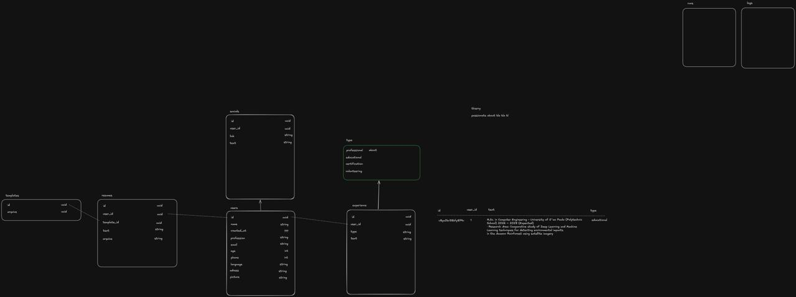

# Database Schema Proposals: Instructions for LLMs

> You are an LLM helping one of the Rayume team members design the database schema.
> Read this whole file before writing anything.

## 1. Context

Read [`../PROJECT.md`](../../PROJECT.md) first. In short, **Rayume** turns a tech worker's **Master Resume** (experiences, education, projects) into ATS-friendly **LaTeX resumes**. An LLM with structured outputs (JSON) rewrites experiences, extracts hard and soft skills, tailors the resume to a job description, and maps the data to each template. Backend: FastAPI, SQLAlchemy 2, PostgreSQL. This is a 2-month MVP built by a 3-person team, so **keep the schema small (about 2 to 5 tables)**.

## 2. How this folder works

Each team member submits one proposal in `sketch/`:

| File | Owner |
|------|-------|
| `raul-schema.md` | Raul Kolaric (done) |
| `lorenzo-schema.md` | Lorenzo Cunha |
| `thierry-schema.md` | Thierry Nadjarian |

The team compares the proposals and merges them into one final schema.

## 3. What has been done so far

### Raul's original sketch

Tables in the sketch: `users` (id, name, created_at, profession, email, age, phone, language, address, picture), `socials` (id, user_id, link, text), `experience` (id, user_id, type, text), a `type` list (professional, educational, certification, volunteering, about), `resumes` (id, user_id, template_id, text, arquivo), `templates` (id, arquivo), plus empty `cms` and `logs` boxes.

### Changes an LLM (Claude) made to get from the sketch to `raul-schema.md`

| Sketch | Proposal | Why |
|--------|----------|-----|
| `socials` table | `users.links jsonb` | A few links per user don't need a table and joins |
| `type` table | `experience_type` Postgres enum | It's a fixed list, not data |
| No `project` type | Added `project` | Projects are central to the product pitch |
| `about` as a type | `users.summary` | It's a single summary, not an experience entry |
| `experience.text` | `raw_text` + `data jsonb` | Templates need structured fields (title, org, dates, bullets, skills). `data` stores the AI's structured output |
| `users.age` | Removed | Resumes shouldn't carry age (risk of age discrimination) |
| `phone int` | `phone text` | An int loses the leading `+` and zeros |
| `picture` | `picture_url` | Files go in object storage, not the DB |
| `resumes.text` / `arquivo` | `content jsonb` / `pdf_url` (plus `title`, `job_description`) | Structured content can be re-rendered with any template, and `job_description` stores the tailoring input |
| `templates.arquivo` | `name`, `tex_source`, `preview_url`, `tags` | The gallery needs names, previews and search |
| `cms`, `logs` | Removed | Logs go to app logging; cms is undefined and not MVP |
| Portuguese names (`arquivo`) | English names | Project convention: code is in English |

Result: 4 tables (`users`, `experiences`, `resumes`, `templates`).

### Update: in-house JWT auth

The directors asked us to **implement JWT auth ourselves** (for learning), so there is no auth library. `raul-schema.md` added the following for that:

| Change | Why |
|--------|-----|
| `users.password_hash` (nullable) | Email/password login. Null for OAuth-only users |
| `users.github_id`, `users.google_id` (unique, nullable) | Link OAuth identities. Two fixed providers, so columns instead of an `accounts` table |
| `refresh_tokens` table (`token_hash`, `expires_at`, `revoked_at`) | Access JWTs are stateless and not stored. Hashed refresh tokens allow rotation, logout and revocation |

Result: 5 tables.

## 4. Your task

1. Read `raul-schema.md`, and any other `*-schema.md` files in `sketch/`.
2. Interview your team member about their ideas, or start from their sketch if they have one.
3. **Critically review the existing proposals.** Don't just agree. If you disagree with something (a table, a column, a type, a relationship, a design choice), **change it in your own proposal** and explain why.
4. Write the result to `sketch/<name>-schema.md`.

### Rules

- **Never edit another member's `*-schema.md`.** Put your disagreements in your own file.
- Use English identifiers, `snake_case` plural table names, `uuid` primary keys and `timestamptz` timestamps.
- Stay inside MVP scope (see `PROJECT.md`). No tables for future features such as scoring, job alerts, billing or auto-apply.
- Auth is **in-house JWT** (a directors' requirement), so your schema must support it: password hashes, OAuth identity linking (GitHub/Google), and refresh tokens. Never store plain passwords, raw refresh tokens or access tokens.
- If you add a picture, save it as `sketch/<name>-sketch.png` and embed it.

### Required format for `<name>-schema.md`

1. A header with the status (`proposed`) and the author.
2. A **Mermaid `erDiagram`** (GitHub renders it).
3. A short note per table explaining its columns and design choices.
4. A **"Differences from other proposals"** section: a table with what you changed, from what to what, and why. Write "agree" for points you checked and kept.
5. A "Not in this schema" section.
