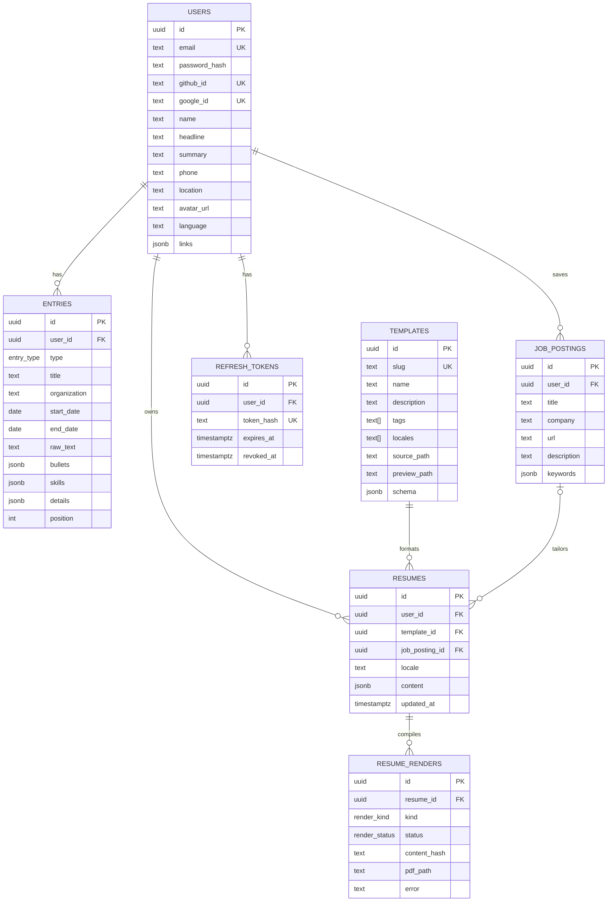

# Database Schema: Lorenzo's proposal

> Status: **proposed**. Author: Lorenzo Cunha.
> PostgreSQL (hosted on Supabase) via SQLAlchemy 2 + psycopg 3. Compared against [`raul-schema.md`](raul-schema.md).
> Product context: [`../../PROJECT.md`](../../PROJECT.md).

## Diagram

Enums:
- `entry_type`: `professional | education | project | certification | volunteering` (same as Raul's)
- `render_kind`: `pdf | preview`
- `render_status`: `queued | running | ok | failed`

## Auth: in-house JWT
Same design as `raul-schema.md` (a directors' requirement), so Supabase Auth is **not** used. Supabase is only the Postgres host and the file storage.
- Access JWT: short-lived, signed by the backend, never stored.
- Refresh token: random string, only its SHA-256 is stored in `refresh_tokens`; rotated on every refresh, `revoked_at` set on logout.
- Email login: `users.password_hash` (argon2 or bcrypt). GitHub/Google login: `github_id` / `google_id`.
- Authorization is enforced in the backend (every query filters by the user id from the JWT). Supabase RLS can't help here because it relies on Supabase Auth's `auth.uid()`.

## Tables

### users
One row per person; the owner of the Master Resume. There is no separate Master Resume table: the Master Resume is `users` + `entries`.
- `email` is unique. `password_hash` is null for OAuth-only users.
- `github_id` / `google_id`: columns instead of an accounts table (two fixed providers).
- `headline` is the professional title (e.g. "Backend Developer"); `summary` is the "about me" text.
- `phone` is text. `avatar_url` points to object storage. No `age` column (age discrimination risk).
- `language` (`en` | `pt-BR`) is the default language of the user's content and of the UI. A resume can override it in `resumes.locale`.
- `links` is a JSON array: `[{ "label": "GitHub", "url": "https://..." }]`.

### entries
Every entry of the Master Resume in **one table**, discriminated by `type`: jobs, education, projects, certifications, volunteering. Adding a new kind of entry needs no migration, and CRUD, ordering and the AI prompts all share one shape.
- `title` is the role, project name or degree; `organization` is the company or institution.
- `raw_text` is what the user typed, kept as is.
- `bullets` is the AI-refined list of achievements (jsonb array of strings). The user can edit them.
- `skills` is a jsonb array: `[{ "name": "React", "kind": "hard" }, { "name": "Leadership", "kind": "soft" }]`. No skills catalog: matching against a job's keywords is done by the AI, so a normalized table isn't needed for the MVP.
- `details` holds type-specific fields (project `url`, education `degree`, certification `issuer`...), so the main columns stay generic.
- Validate `bullets`, `skills` and `details` with Pydantic schemas in the backend.

### job_postings
A job captured by the browser extension or pasted in the app. Needed by feature 3 (job tailoring).
- `description` is the raw text; `keywords` is the AI-extracted list used for tailoring.
- A resume tailored to a job points to it through `resumes.job_posting_id`; generic resumes leave it null.

### templates
The LaTeX gallery. Written by the team, not uploaded by users. A single table, with no versioning: updating a template applies to every resume that uses it.
- `slug` is a stable identifier. `tags` and `locales` power gallery search and filtering.
- `source_path` (the `.tex` file) and `preview_path` (the image) are paths in Supabase Storage (bucket `templates`). Files are never stored in the DB.
- `schema` is the template's contract: sections, bullet and character limits, and section labels per language. It's what the AI receives so its output fits the layout ("map to templates").
- The engine is always pdfLaTeX, so there is no `engine` column.

### resumes
The current state of one generated resume: Master Resume + (optionally) a job + one template.
- `content` is the template-ready JSON. It can be edited by the AI **and by the user** before compiling. Only the current state is kept, with no history.
- `locale` is the resume's language. If it differs from `users.language`, the AI translates when generating; the Master Resume stays single.
- Switching template means changing `template_id` and re-rendering; no new AI call if the content already fits the new template's `schema`.

### resume_renders
One row per LaTeX compilation of a resume (the PDF or a gallery preview). Replaces `resumes.pdf_url`.
- Compilation is **asynchronous**: LaTeX can't run on a serverless host like Vercel, so a separate worker (Docker + TeX Live) does it. The API inserts a row with `status = queued`; the worker claims it (`FOR UPDATE SKIP LOCKED`), compiles in a sandbox, uploads the PDF and sets `ok` or `failed`.
- `kind = preview` rows feed the live preview gallery (page 1 as an image); `kind = pdf` rows are the exports.
- `content_hash` (hash of content + template) avoids recompiling identical input. Suggested unique index: `(resume_id, kind, content_hash)`.
- `pdf_path` is a path in Supabase Storage (bucket `renders`, private, served through short-lived signed URLs). `error` holds the failure message and the compile log.

### refresh_tokens
Same as in `raul-schema.md`: one row per active session. Valid while `revoked_at IS NULL AND expires_at > now()`; rotated on every refresh.

## Differences from other proposals

Compared with `raul-schema.md`:

| Point | Raul | Lorenzo | Why |
|-------|------|---------|-----|
| Auth, `users` columns, `refresh_tokens` | in-house JWT | agree | Directors' requirement |
| `users` name fields | `profession`, `address`, `picture_url` | `headline`, `location`, `avatar_url` | Naming only. Same meaning |
| `users.created_at` and other `created_at` | present | removed | Not needed for any MVP feature. Easy to add back (e.g. to `resume_renders` to expire old PDFs) |
| `experiences` | `experiences` with `type`, `raw_text`, `data jsonb` | `entries` with generic columns + `bullets`, `skills`, `details` | `title`, `organization` and dates are queried and ordered, so real columns are easier than digging in jsonb. The rest stays jsonb. The enum values are unchanged |
| Skills | inside `data` (`hard_skills`, `soft_skills`) | `entries.skills` as `[{name, kind}]` | One list with a `kind` flag instead of two lists. Still no catalog table |
| Job description | `resumes.job_description` (text) | `job_postings` table + `resumes.job_posting_id` | The extension captures a title, company, URL and description, and the AI extracts keywords. This is one extra table over Raul's |
| `resumes.title` | present | removed | The resume's name can be derived from the template and job |
| `resumes.pdf_url` | single PDF URL | `resume_renders` table | Compilation is async and can fail (needs status and error). A resume has several files (PDF, previews, one per edit), and `content_hash` avoids recompiling. Needed by the live preview gallery |
| `templates` source | `tex_source` text column; alternative: files in the repo | `source_path` in Supabase Storage | Keeps large text out of the table and lets the worker fetch it by path. Files in the repo with a slug is also a fine option, and is simpler if templates rarely change |
| `templates` columns | `name`, `tex_source`, `preview_url`, `tags` | adds `slug`, `description`, `locales`, `schema` | `schema` is the contract the AI maps data to, and `locales` supports English-first with pt-BR |
| Resume language | `users.language` only (UI) | adds `resumes.locale` | The audience is English-first, but users may want the same resume in pt-BR without duplicating the Master Resume |
| Table count | 5 | 7 (adds `job_postings`, `resume_renders`; `entries` replaces `experiences`) | Above the "about 2 to 5" guideline. The two extra tables come from features in scope: job tailoring (3) and gallery preview + PDF export (4, 5). If we need to cut, merge `job_postings` into `resumes` as a jsonb column |

