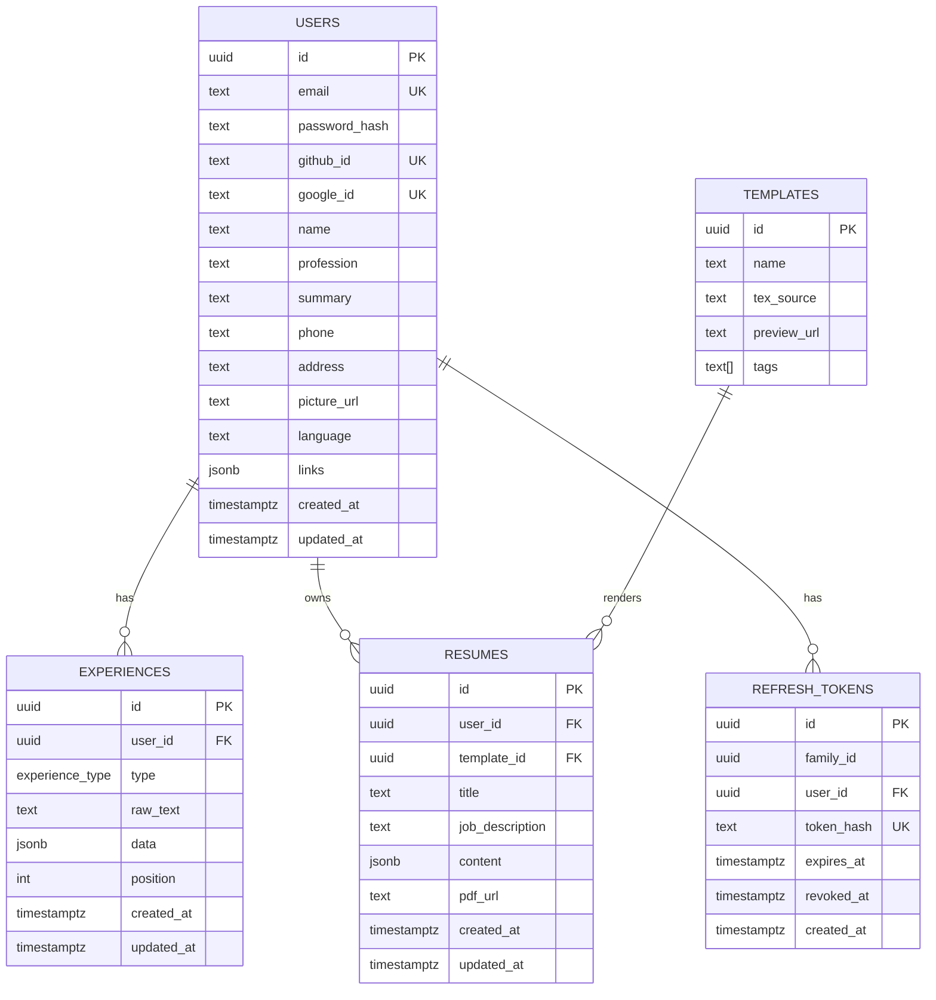

# Database Schema — Thierry

> Changes: update timestamps, complete resume snapshots, refresh-token families and JWT validation.

## Diagram

`experience_type`: `professional | education | project | certification | volunteering`.

## Tables

| Table | Purpose |
|---|---|
| `users` | Account, login providers and personal profile. |
| `experiences` | Master Resume entries; original text in `raw_text`, structured information in `data`. |
| `resumes` | Saved, tailored resumes with their own content and PDF URL. |
| `templates` | LaTeX layouts, previews and search tags. |
| `refresh_tokens` | Hashed refresh tokens, including retained revoked tokens from each login. |

## Proposed changes

### 1. Update timestamps

Add `updated_at` to `users`, `experiences` and `resumes`. Initialize it on creation and update it whenever the record changes. Keep `created_at` as the original creation time.

This records when a profile, entry or saved resume was last edited. The backend must implement timestamp updates; the column alone does not track changes automatically.

### 2. Complete resume snapshots

Keep `resumes.content` as a complete copy of the information selected for that resume, including name, contact details and tailored entries. Rendering the saved content must not silently pull newer profile information.

The Master Resume remains editable. Updating it does not automatically change previously saved resumes; users can explicitly edit a saved resume or generate another one.

**Example:** a support resume keeps its selected content when the user later adds a development job to the Master Resume.

Raul already stores final content in JSON. This proposal clarifies its completeness and independence; it adds no snapshot column or table. It preserves content, not a history of every edit or a version of the template.

### 3. Refresh-token families

Add `refresh_tokens.family_id` (`uuid`, non-null, indexed) to group tokens issued through the same login. A separate login creates a new family.

- Store only the token hash. Keep the existing expiry and revocation fields.
- On renewal, revoke the current refresh token and insert its replacement in one transaction. Both rows share `family_id`; only one renewal may consume the current token.
- If a previously rotated token is reused, reject it and revoke all active refresh tokens in that family. Other login families are unaffected.
- Keep revoked hashes until the family expires so reuse can be detected.
- Suggested lifetime: 30 days from the original login. All replacements inherit that expiry; rotation does not extend it.

**Example:** refresh tokens A → B → C belong to one login. Once C is current, A and B cannot renew access. Reuse of A also revokes C.

Refresh-token revocation prevents renewal. An already-issued access JWT can remain valid until it expires.

### 4. JWT validation

Keep short-lived access JWTs (suggested: 15 minutes), issued by the backend and not stored in the database. At login, issue both an access JWT and a refresh token; successful renewal issues a new access JWT and rotates the refresh token.

For protected requests, the backend must:

- Verify the signature using a trusted key and an explicitly allowed algorithm.
- Require and validate `exp` (expiry), `iss` (expected issuer) and `aud` (this API).
- Require `sub` to identify a valid application user; validate `nbf` when present.
- Check that the identified user is authorized to access the requested resource.

This is backend behavior, not an additional database table. Use a maintained JWT library for cryptographic verification. A signed JWT payload is readable, so it must not contain passwords or secrets.

## Differences from Other Proposals

| Point | This proposal adds |
|---|---|
| Updates | `updated_at` in three tables. |
| Saved content | Explicitly complete, independent snapshots in the existing `content` field. |
| Refresh rotation | `family_id`, family-wide revocation on reuse and a fixed session deadline. |
| Access JWT | Explicit algorithm, issuer, audience and subject validation alongside signature and expiry. |

The five-table structure, `resumes.pdf_url`, templates and UI language remain as in the base schema.
