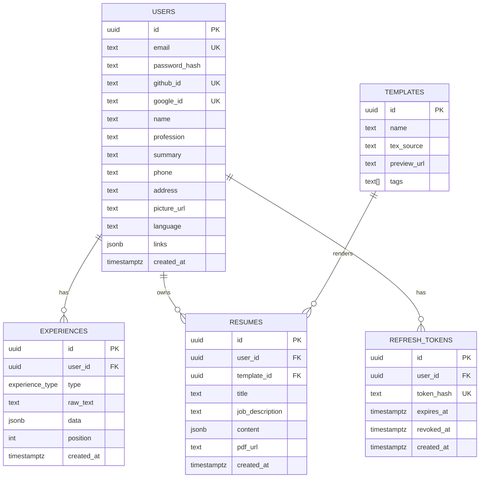

# Database Schema

> AI-oriented. PostgreSQL via SQLAlchemy 2 + psycopg 3. Status: **proposed**, not yet implemented.
> Product context: [`../PROJECT.md`](../PROJECT.md).

## Diagram

`experience_type` enum: `professional | education | project | certification | volunteering`

## Auth: handled in-house with JWT
The directors asked us to implement JWT auth ourselves (for learning), so **no auth library and no third-party auth tables**.
- **Access token**: a short-lived JWT (about 15 min), signed by the backend and **never stored** in the DB. It's validated by its signature and `exp` claim alone.
- **Refresh token**: a long-lived random string (about 30 days). Only its **hash** is stored in `refresh_tokens`. It is rotated on every refresh, and logout sets `revoked_at`.
- **Email login**: the password is hashed (argon2 or bcrypt) into `users.password_hash`.
- **GitHub/Google login**: the backend runs the OAuth flow, matches the provider's user id to `github_id` / `google_id`, then issues our own JWT.

## Tables

### users
The Master Resume owner. One row per person.
- `email` is unique.
- `password_hash` is null for users who only log in through OAuth. Never store plain passwords.
- `github_id` / `google_id` hold the OAuth provider's user id. They're unique and null if that provider isn't linked. Columns instead of an `accounts` table, since there are only two fixed providers.
- `phone` is **text**, not int, so it keeps the leading `+` and zeros.
- `summary` holds the "about me" text. It is **not** an experience.
- `language` is the UI preference: `en` | `pt-BR`.
- `links` is a JSON array: `[{ "label": "GitHub", "url": "https://..." }]`. This replaces a separate socials table.
- `picture_url` points to object storage; the file is never stored in the DB.
- No `age` column, on purpose: resumes shouldn't carry it (risk of age discrimination).

### experiences
Every entry of the Master Resume: jobs, education, projects, certifications, volunteering.
- `raw_text` is what the user typed, kept as is.
- `data` is the AI's **structured output**, validated by a Pydantic schema in the backend (title, organization, start/end, location, bullets, hard_skills, soft_skills). Templates render from `data`, never from `raw_text`.
- `position` sets the order within a user's list.

### resumes
A generated resume: the Master Resume tailored to one job and rendered with one template.
- `job_description` is the tailoring input (pasted in the app or captured by the extension). It can be null for a generic resume.
- `content` is the final template-ready JSON produced by the AI. Rendering it with a different template doesn't need a new AI call.
- `pdf_url` points to the compiled PDF in object storage.

### templates
The LaTeX template gallery. Templates are written by the team, not uploaded by users.
- `tags` power the gallery search.
- Alternative under consideration: keep templates as files in the repo with a manifest, and store a `template` slug on `resumes` instead of a foreign key.

### refresh_tokens
One row per active login session (device). This is what makes logout and revocation possible with stateless JWTs.
- `token_hash` is the SHA-256 of the refresh token. The raw token is only sent to the client.
- A token is valid when `revoked_at IS NULL AND expires_at > now()`.
- On refresh: revoke the old row and insert a new one (rotation). Deleting expired rows is a cleanup task.

## Not in this schema
- **Sessions table**: access JWTs are stateless; `refresh_tokens` covers sessions.
- **Logs**: they go to application logging, not the DB.
- Future (non-MVP) features such as scoring, jobs or billing get no tables until they're in scope.
