# Rayume Design System

> Status: **accepted**. This is the visual language for the whole site, taken from the shipped landing page (`frontend/app/`).
> Stack: Next.js 16, Tailwind CSS 4, Geist Sans + Geist Serif. Product context: [`../PROJECT.md`](../PROJECT.md).

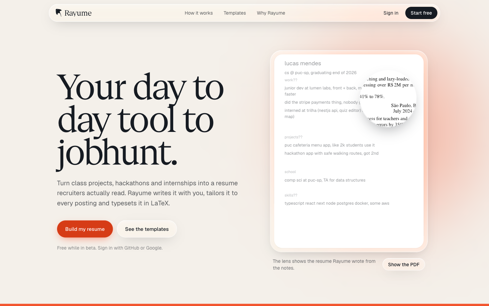

**The idea in one line:** warm paper, navy ink and one loud ultramarine, with Apple-style liquid glass where there is colour behind it to bend. Sophisticated enough to trust with your career, modern enough for a Gen Z job hunter.

## Contents

1. [Principles](#principles)
2. [Colour](#colour)
3. [Typography](#typography)
4. [Layout](#layout)
5. [Responsive](#responsive)
6. [Surfaces: liquid glass](#surfaces-liquid-glass)
7. [Shape and depth](#shape-and-depth)
8. [Components](#components)
9. [Motion](#motion)
10. [Voice and copy](#voice-and-copy)
11. [Accessibility](#accessibility)
12. [Assets](#assets)
13. [How it is built](#how-it-is-built)
14. [Do and don't](#do-and-dont)

---

## Principles

| | Principle | In practice |
|---|---|---|
| 1 | **Paper first** | The page is cream paper (`paper`). Navy (`ink`) does the talking. Ultramarine is a highlighter, not a wallpaper, except in the one band built to show it off. |
| 2 | **One loud thing per screen** | Each section has a single star: the lens in the hero, the glass cards in the band, the PDF in the steps. Everything around it stays quiet. |
| 3 | **Glass needs something to bend** | Liquid glass only goes over colour or content (the nav while scrolling, cards on ultramarine). Glass on flat cream is just a grey box. |
| 4 | **Show the real thing** | Resumes are real LaTeX renders of a real (fictional) person, never lorem ipsum or grey bars. |
| 5 | **Alive, but calm** | Motion answers the user (the lens follows the cursor, the nav reacts to scrolling, demos play when they scroll into view). The only ambient loop is the ocean in the ultramarine band: slow, low contrast, behind glass. |
| 6 | **Accessible by default** | Every text pairing passes WCAG AA. Every effect has a reduced-motion fallback. |

---

## Colour

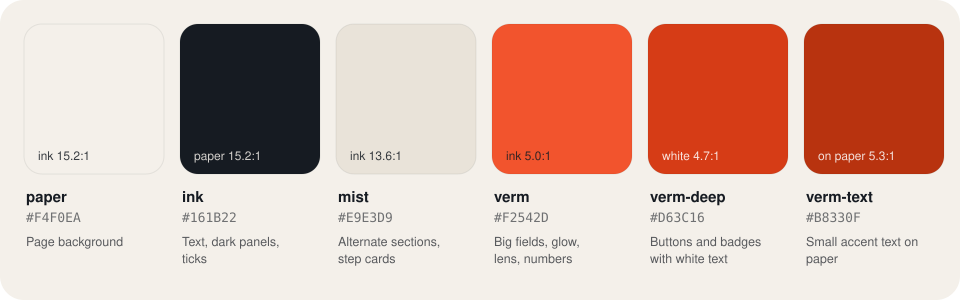

All colours are Tailwind theme tokens in `frontend/app/globals.css` (`@theme`). Use the token names, never raw hex: `bg-paper`, `text-ink`, `bg-mist`, `bg-accent`, `bg-accent-deep`, `text-accent-text`. Opacity modifiers work as usual (`text-ink/60`, `bg-accent/15`).

The accent is **ultramarine**, picked in November 2026 over vermilion, cobalt, violet, emerald and magenta. It replaced vermilion, so older screenshots in this doc still show the vermilion version; the layout and rules are the same.

| Token | Hex | Use it for | Never use it for |
|---|---|---|---|
| `paper` | `#F4F0EA` | Page background, light text on `ink` | Cards on paper (no contrast) |
| `ink` | `#161B22` | All body text, headings, dark panels, ticks, secondary buttons | Large decorative fields, text on `accent` (2.6:1 fails) |
| `mist` | `#E9E3D9` | Alternate sections (templates), step cards | Text |
| `accent` | `#4338F5` | The accent band, glows, the lens, large numerals, outlines | Navy text on top (2.6:1 fails); use white |
| `accent-deep` | `#271BF4` | Primary buttons, badges, accent ticks, anything with **white text on it** | Large areas (looks heavy) |
| `accent-text` | `#180BEA` | Small accent text on paper (labels, links, skill names), focus rings | Backgrounds |

The ocean in the band reads four shades derived from these tokens (`--ocean-deep`, `--ocean-shade`, `--ocean-mid`, `--ocean-light` in `globals.css`), so changing the three hex values above recolours the whole site.

### Why three ultramarines

The base shade is the brand. The two deeper ones keep contrast for small text and for white text on solid fills:

| Pair | Ratio | Passes AA for |
|---|---|---|
| `ink` on `paper` | 15.2 : 1 | All text |
| `ink` on `mist` | 13.6 : 1 | All text |
| white on `accent` | 6.7 : 1 | All text (that is why the accent band uses white text) |
| `ink` on `accent` | 2.6 : 1 | Fails, never use |
| white on `accent-deep` | 8.2 : 1 | All text (buttons) |
| `accent-text` on `paper` | 8.1 : 1 | All text |
| `accent` on `paper` | 5.9 : 1 | All text |
| white on dark glass over `accent` | 5.9 : 1 | All text (the band's cards) |

### Proportions


---

## Typography

Two families from Vercel's [Geist](https://vercel.com/font), installed from the `geist` npm package (Geist Serif is not on Google Fonts yet):

| Role | Family | Import | Where |
|---|---|---|---|
| Display | **Geist Serif Regular** | `import { GeistSerifRegular } from "geist/font/serif/regular"` | `h1`, `h2`, the wordmark, large numerals, the glass card quotes |
| Text | **Geist Sans** | `next/font/google` in `layout.tsx`, exposed as `font-sans` | Everything else |

Geist Serif ships one weight (400) and no italic. Emphasis comes from **size and colour, never from fake bold or slanted text**.

### Scale

| Name | Class | Size | Line height | Tracking |
|---|---|---|---|---|
| Display (hero `h1`) | `text-[clamp(3.1rem,7.4vw,6.4rem)]` | 50 to 102 px | `leading-[0.94]` | `-0.035em` |
| Section (`h2`) | `text-[clamp(2.4rem,4.6vw,3.8rem)]` | 38 to 61 px | `leading-[1]` | `-0.03em` |
| Closing (`h2` in the dark panel) | `text-[clamp(2.4rem,5.4vw,4.6rem)]` | 38 to 74 px | `leading-[1]` | `-0.03em` |
| Card quote | `text-[22px] sm:text-2xl` (serif) | 22 to 24 px | `leading-snug` | default |
| Lead | `text-[19px]` / `text-lg` | 18 to 19 px | `leading-[1.55]` | default |
| Body | `text-[15px]` | 15 px | `leading-relaxed` | default |
| Small | `text-sm` / `text-[13px]` | 13 to 14 px | default | default |

Rules:
- Headings are **sentence case**. No all-caps labels, no tracked-out eyebrows.
- Do **not** colour or italicise a single word in a headline. The headline is set in one colour.
- Keep lines under ~75 characters: `max-w-[34rem]` for lead paragraphs, `max-w-xl` for section intros.

---

## Layout

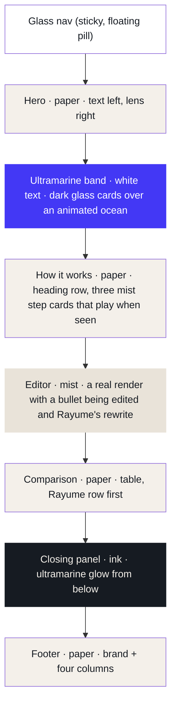

| Token | Value | Notes |
|---|---|---|
| Container | `mx-auto max-w-6xl` | 72 rem (1152 px) for every section |
| Gutter | `px-4 sm:px-6` | 16 px on phones, 24 px from `sm` |
| Section rhythm | `py-28 lg:py-36` | 112 px, 144 px on desktop |
| Hero grid | `lg:grid-cols-[1.08fr_0.92fr]` | Text slightly wider than the visual |
| Section header | `grid lg:grid-cols-2 lg:items-end` | Heading left, short intro right (`lg:justify-self-end`). Content goes full width below, so no column is left empty |
| Card grids | `md:grid-cols-2`, `lg:grid-cols-3` | Grids always start at `grid-cols-1` so they shrink on phones |

Alignment is **left** everywhere except the closing panel, which is centred because it is a single call to action. Backgrounds alternate paper, ultramarine, paper, mist, paper, ink, paper, so each section reads as its own sheet.

---

## Responsive

The landing page is the reference: check it at 320, 375, 768, 1024 and 1440 px before shipping a page. The project's [`responsive-design` agent](../../.claude/agents/responsive-design.md) applies the general rules; this section is what Rayume adds on top.

| Phone hero, first screen | Mobile menu | Comparison on a phone |
|---|---|---|
| 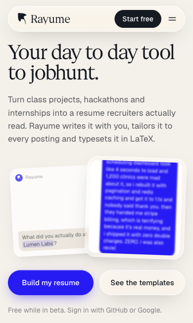 | 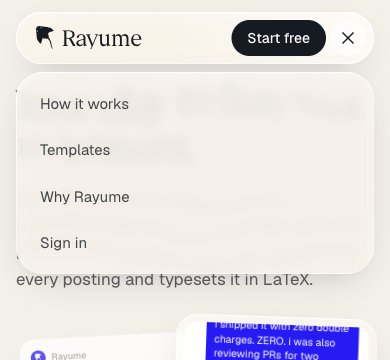 | 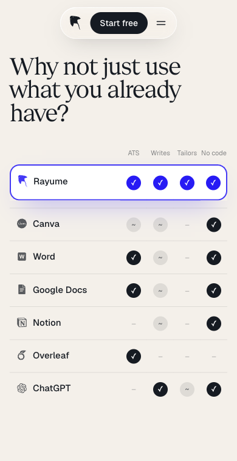 |

### Rebuild for the phone, keep desktop as it is

Don't squeeze a desktop composition until it fits. When a section doesn't work on a phone, build a phone version that does the same job and keep the desktop one untouched. Render both and switch with `lg:hidden` / `max-lg:hidden`, so neither leaks into the other.

| Section | Desktop (`lg` and up) | Phones and tablets |
|---|---|---|
| Hero visual | The lens over the notes (`lens.tsx`) | A short story between the pitch and the buttons (`hero-phone.tsx`) |
| Comparison | Full table with a one-liner per tool | One compact matrix: Rayume's row outlined first, four marks per tool under short headings, no one-liners |
| Nav links | Inline in the pill | Menu button under `md`, panel under the pill (`nav.tsx`) |
| Footer | Brand plus four columns in one row | Brand on its own row, columns below (five in a row only from `lg`) |

`lg` (1024 px) is the switch for compositions; `sm` and `md` only adjust spacing and grids.

### The first screen

On a phone the hero's title, pitch, visual and both buttons must all be visible without scrolling, from 320×568 to 430×932. What makes it fit:

- Phone-sized type and spacing: the title drops to `clamp(2.5rem,…)` (two lines, not three), the pitch to 17 px, `pt-8` above it and `mt-5`/`mt-6` between blocks.
- The buttons sit side by side from 360 px (`min-[360px]:flex-row`, `flex-1`, `px-4`).
- The visual is sized from the screen height, steeply: `h-[clamp(5.5rem,41.7svh-9.3rem,14rem)]` is about 88 px on a 568 px phone, 200 px on 844 px, capped at 224 px. Use `svh`, so the browser's toolbar can't push the buttons off.
- Anything inside a shrinking box fills it and clips (`top-3 bottom-0 overflow-hidden`), with the text anchored to the bottom so the newest line stays visible.

Measure it: the hero buttons' bottom edge must sit inside the viewport at each of those sizes.

### Less text beats sideways scrolling

Nothing on a page scrolls sideways at any width. When a table or row doesn't fit, take text out on phones instead of adding a horizontal scroller: the comparison drops its one-liners and uses short headings (`ATS`, `Writes`, `Tailors`, `No code`) with the full criterion in an `<abbr title>`. Columns narrow a little below 360 px so names like "Google Docs" stay on one line.

### Touch

- Inputs and the code editor use 16 px text below `sm`: anything smaller makes iOS zoom the page on focus.
- Filter chips and pill buttons grow to 44 px tall on touch screens only (`pointer-coarse:`), so desktop keeps its tighter rhythm.
- Tailwind v4 already applies `hover:` only on devices that can hover; don't wrap it again.
- Use `dvh`/`svh` for full-height layouts, not `vh`.

### Motion on a phone: a story, not decoration

The phone hero tells the product in one loop instead of showing a static picture. Its techniques are reusable:

- **Typewriter.** Characters revealed by a timer chain (faster for a rant: four characters every 22 ms), a blinking caret while typing.
- **Turn-taking cards.** The card whose turn it is comes to the front at full size; the other sinks to `scale-[0.93]` and 75% opacity. Swap with a 500 ms transition on scale, opacity and `z-index`.
- **Text flying up.** Messages sit on the bottom edge and grow upward. Each new line would jump the stack, so a `ResizeObserver` plays the jump back as a 240 ms slide with a 1.5 px blur (FLIP); fast typing reads as a flood of text.
- **Highlights.** A `<mark>` whose background sweeps from `bg-size-[0%_100%]` to `100%` in `accent/20`. Set `bg-transparent` too, or the browser's yellow `<mark>` fill shows through.
- **Camera moves.** On a small screen zoom far in (4.6× on a name, 3.4× on a section), ease every move in and out (`cubic-bezier(0.65,0,0.35,1)`) with a hold between moves, and add a motion blur on a wrapper that peaks mid-move (3 px) and is 0 on every hold. Aim points come from the PDF (fractions of the page) and are converted to the `object-contain` box at run time. Zoom a vector (`classic.svg`), never a PNG.
- Decorative stories are `aria-hidden`, and reduced motion shows the final frame, still.

### Gotchas we hit

- A pinned (`sticky`) table column needs an opaque background, and that background paints over neighbouring rows' shadows: the highlighted row's glow lost a rectangle. Pin nothing that sits next to a shadow; on phones, rebuild the table instead.
- Fixed `max-width` transitions finish early when the guess is bigger than the content. Animate `grid-template-columns: 0fr → 1fr` (or rows) to reach the real size.
- In `next dev`, edits to `globals.css` sometimes never reach the browser. If a new token or keyframe is missing, restart the dev server and delete `.next/dev`.

---

## Surfaces: liquid glass

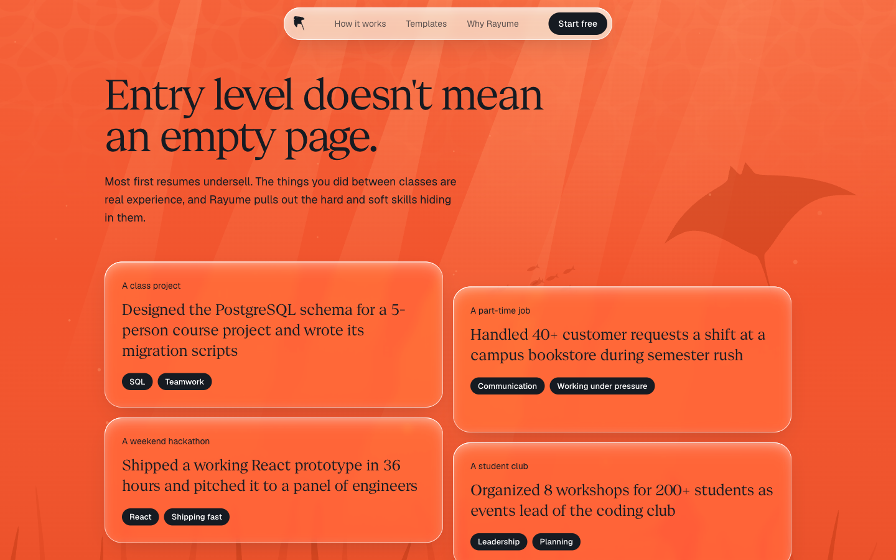

Two Tailwind utilities, defined with `@utility` in `globals.css`:

```html
<div class="glass rounded-[28px] p-6">…</div>        <!-- light glass, on colour or content -->
<a class="glass glass-dark rounded-full …">…</a>   <!-- on dark panels -->
```

### Anatomy

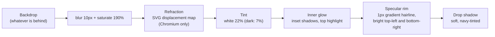

- **Refraction** comes from `<Refraction />` in `lens.tsx`: it injects the SVG filter `#lg-refract` and sets `data-refract` on `<html>` in Chromium, where `backdrop-filter: url()` works. Safari and Firefox keep the plain blur instead of losing the backdrop.
- **Prism glass** (`glass-prism`, in `prism.css`) goes over `glass` on the nav pill and its phone menu, the four band cards, the hero's "See the templates", the lens toggle and "Get the extension": an uneven rainbow rim, pink light from the top left and cyan from the bottom right, a lighter 4px blur (bent through `#lg-refract` in Chromium) and no cursor light. Only there: everywhere it read as too much. On paper it keeps the white frosting so text stays readable.
- **Readability over busy colour:** when glass carries text over ultramarine or ink (the compact nav), raise the tint: `bg-paper/75!`.

| Use glass | Don't use glass |
|---|---|
| The nav (content scrolls under it) | Cards on flat paper (use `bg-mist` or white) |
| Cards and chips on the ultramarine band | Body text containers on paper |
| Frames around real content (the lens bezel) | Stacked glass on glass |
| Secondary buttons over colour (`glass glass-dark` on ink) | Anything that needs to be read at small size over a busy image |

---

## Shape and depth

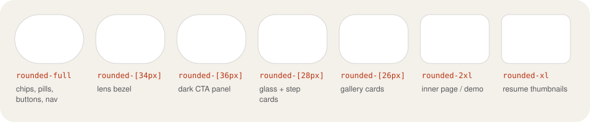

- **Everything interactive is a pill** (`rounded-full`): buttons, chips, filter tabs, the nav.
- Radius grows with size: thumbnails `rounded-xl`, inner panels `rounded-2xl`, cards `rounded-[26px]`/`rounded-[28px]`, big frames `rounded-[34px]`/`rounded-[36px]`.
- **Shadows are tinted, never grey.** Navy shadows for objects on paper (`shadow-[0_12px_32px_-16px_rgb(22_27_34/0.3)]`), ultramarine glow for the primary button and the highlighted table row (`shadow-[0_8px_24px_-8px_color-mix(in_srgb,var(--color-accent)_70%,transparent)]`).
- Big soft colour glows (`bg-accent/25 blur-[120px]`) sit behind the hero visual, the editor section and the closing panel so the glass has colour to pick up.

---

## Components

All live in `frontend/app/`. Copy the class strings; they are the spec.

### Nav (`nav.tsx`)

| Expanded (top of page) | Compact (scrolling down) |
|---|---|
| 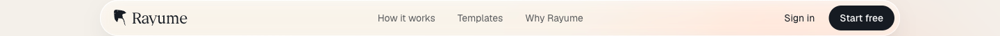 | 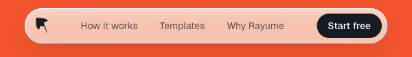 |

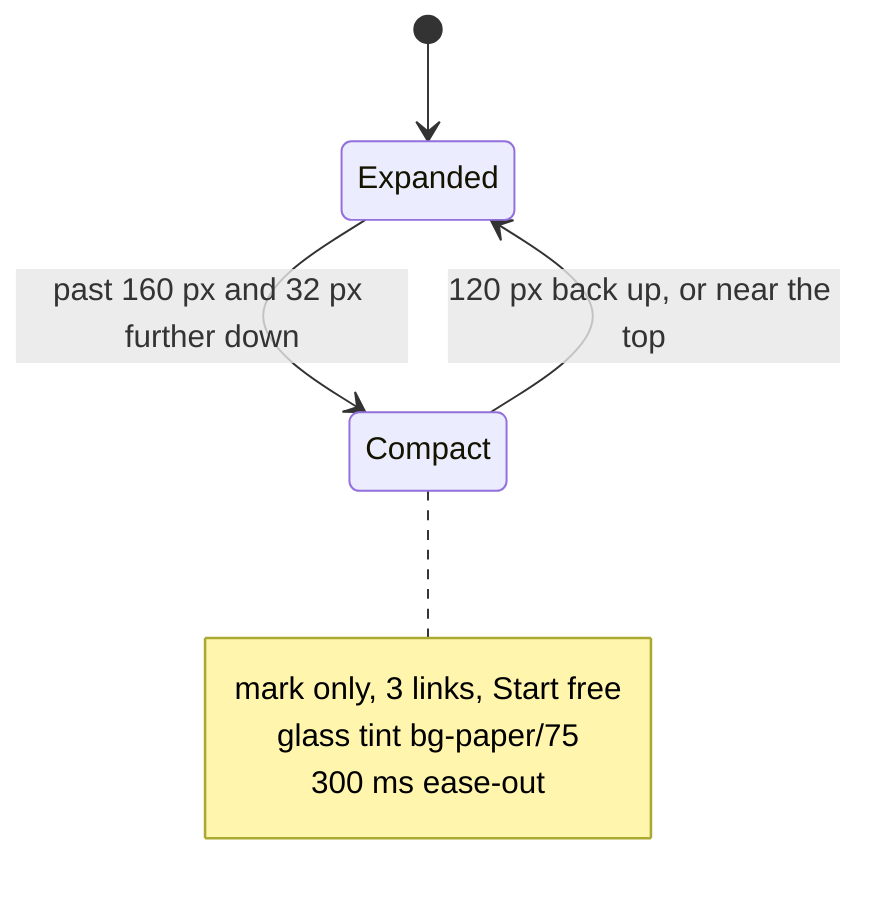

The hysteresis (32 px down, 120 px up) is deliberate: small trackpad flicks never toggle it.

### Buttons

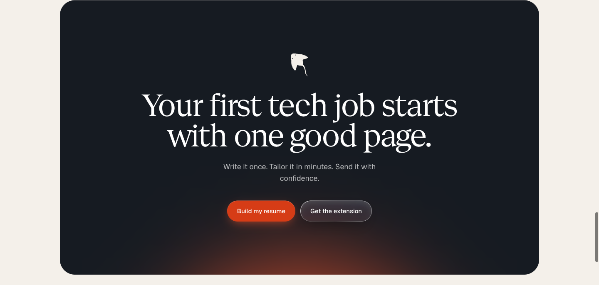

| Variant | When | Classes |
|---|---|---|
| **Primary** | The one action per section ("Build my resume") | `btn` + `bg-accent-deep text-white shadow-[0_8px_24px_-8px_color-mix(in_srgb,var(--color-accent)_70%,transparent),inset_0_1px_0_rgb(255_255_255/0.25)] hover:bg-[color-mix(in_oklab,var(--color-accent)_45%,var(--color-accent-deep))]` |
| **Glass** | Secondary action on paper or colour | `glass` + `btn` + `text-ink hover:bg-white/40` |
| **Dark glass** | Secondary action on `ink` | `glass glass-dark` + `btn` + `text-white hover:bg-white/15` |
| **Ink** | Compact actions in chrome ("Start free" in the nav) | `rounded-full bg-ink px-4 py-2 font-medium text-white hover:bg-ink/85` |

Base: `btn = "inline-flex items-center justify-center rounded-full px-6 py-3.5 text-[15px] font-medium transition active:scale-[0.97]"`. Labels are verbs that say what happens. No arrows appended.

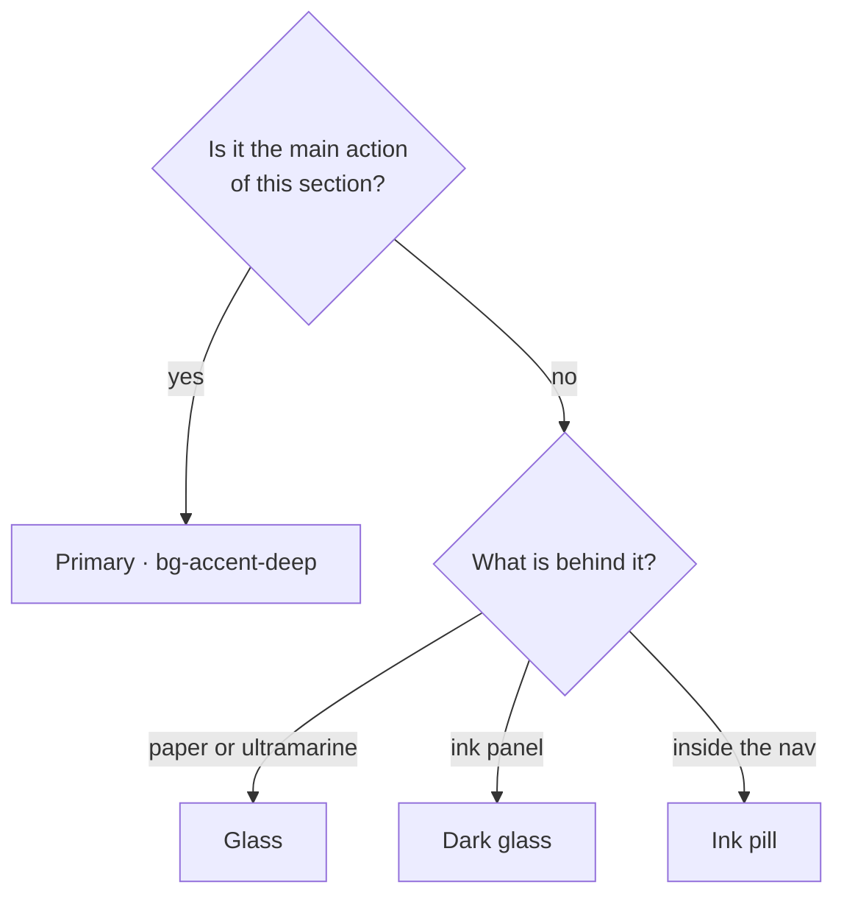

### Cards

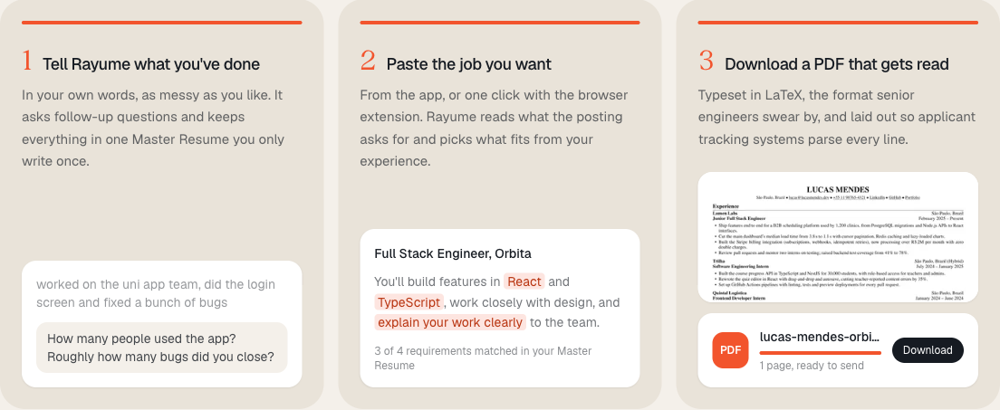

| Card | Classes | Use |
|---|---|---|
| **Step card** | `flex flex-col rounded-[28px] bg-mist p-5 sm:p-6` | Numbered sequences on paper, three in a row (`lg:grid-cols-3`). A thin ultramarine bar on top fills in turn, the numeral (Geist Serif `text-3xl text-accent`) sits inline with the title, and the demo is pinned to the bottom (`mt-auto`). |
| **Glass card** | `glass glass-dark rounded-[28px] p-6 sm:p-7` | On the accent band, white text. Serif quote, navy chips. |
| **Demo panel** | `rounded-2xl bg-white p-4 shadow-[0_1px_2px_rgb(22_27_34/0.08)]` | Small fake UI inside a card (chat, job post, PDF row). |
| **Template card** | `rounded-xl bg-white ring-1 ring-ink/10` + navy shadow, `group-hover:-translate-y-1` | A resume thumbnail on `/templates`; "Use this template" fades in on hover (always shown on touch). |

Numbering (1, 2, 3) is only for real sequences.

### Chips and badges

- Skill chip on the accent band: `rounded-full bg-ink px-3 py-1 text-[13px] font-medium text-white`
- Keyword highlight in text: `<mark class="rounded bg-accent/15 px-1 text-accent-text">`
- Status badge ("Selected", "New"): `rounded-full bg-accent-deep px-2.5 py-0.5 text-xs text-white`
- Filter tabs: a `glass rounded-full p-1` track; active tab `bg-ink text-white`, others `text-ink/70 hover:bg-white/50`

### Hero lens (`lens.tsx`)

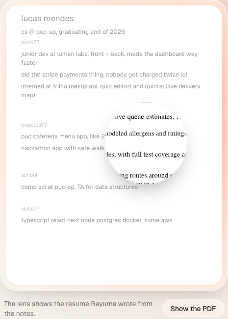

The signature piece: rough notes underneath, the real compiled resume (a vector SVG, so it stays sharp at 2x) inside a magnifying ring.

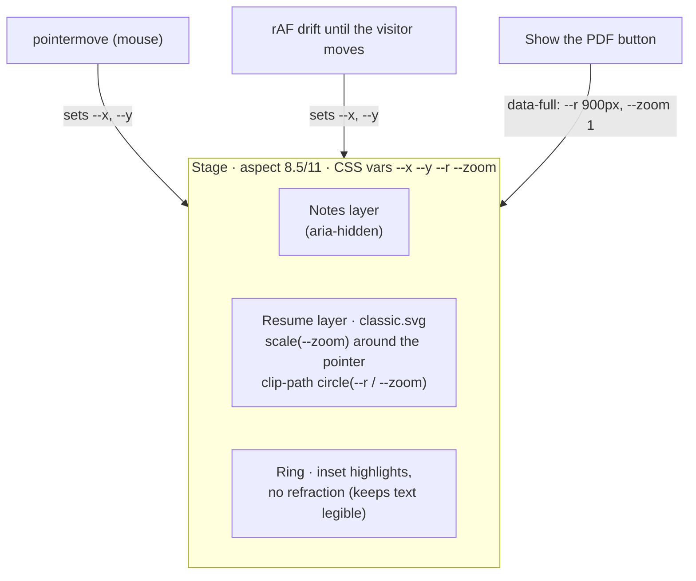

### Template gallery (`/templates`)

The landing page no longer has a gallery section; the templates live on their own page (`templates/browser.tsx`). Every thumbnail is a real compile of the same person (see [Assets](#assets)): the team's Classic and Modern plus Jake's Resume, Awesome CV, AltaCV and moderncv from Overleaf.

- A one-row header with the search, then a filter bar that sticks under the nav: ATS-friendly, layout, colour, density, and sort. Four columns on wide screens, two on phones.
- A card opens the template in a drawer over the grid (`/templates/[id]` on a direct visit), with the pdf.js viewer.
- Filtering animates with the View Transitions API (`document.startViewTransition`, one `view-transition-name` per card) where the browser has it; elsewhere, and with reduced motion, it switches instantly.

### Comparison table

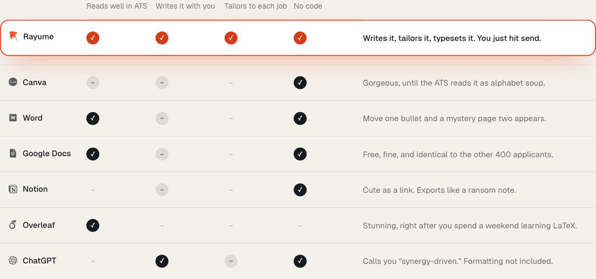

- Rayume row first, outlined in `border-accent` on its cells (rows can't take a radius), accent ticks `bg-accent-deep`, same height as the rest.
- Competitor logos at `size-4 text-ink/70` (`brands.tsx`, Simple Icons, CC0).
- Fixed columns: `table-fixed` with a `<colgroup>`, so headers sit over their ticks.
- Ticks: yes = filled `ink` circle, partly = `ink/10` circle with `~`, no = a faint dash. Each has an `sr-only` label.
- Below `lg` it becomes the compact matrix described in [Responsive](#responsive): same ticks, Rayume's row outlined first, no one-liners.

### Footer

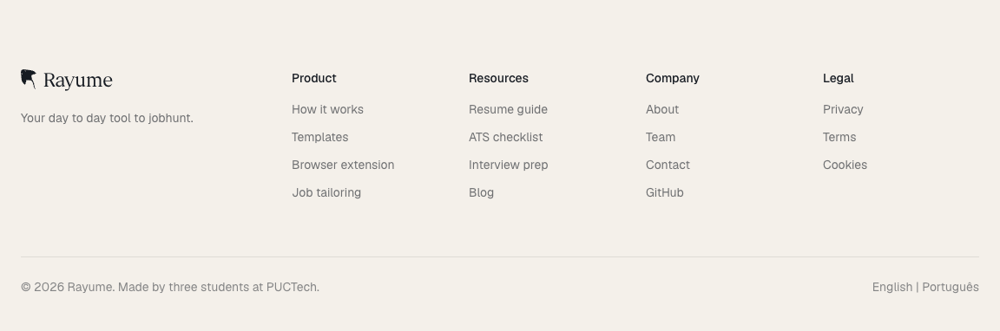

Brand column (mark, wordmark, tagline) plus four columns. Entries are plain text until their pages exist.

---

## Motion

| Moment | What moves | Timing | Reduced motion |
|---|---|---|---|
| Ocean (`ocean.tsx`) | Mantas glide and beat their wings, a fish school passes, god rays sway, caustics shimmer, seagrass bends, specks drift and bubbles rise | SVG + SMIL only (no per-frame JS), loops of 20 to 90 s with negative `begin` so it never visibly restarts; paused while off screen | Frozen on a calm frame |
| Steps (`steps.tsx`) | Progress bars fill in turn, the note types out, keywords light up, the PDF compiles and prints | Once, when the row's top passes 65% of the screen height (a stacked row on a short phone never reaches "35% visible"); CSS transitions staggered by `--d` (0.9 s per card) | Final state, no transitions |
| Phone hero (`hero-phone.tsx`) | Rayume asks, he rants (lines fly up with a blur), "thats about it", Rayume answers, his card compiles, then a camera move over his new resume and his reaction | One loop of about 24 s; timers for the typing, Web Animations for the camera (eased holds, motion blur mid-move) | Final frame: the finished resume, still |
| Lens drift | Lens wanders over the page until the visitor moves the mouse | `requestAnimationFrame`, slow sine path | Static |
| Lens toggle | Radius and zoom open to the full page | 700 ms `cubic-bezier(0.2,0.8,0.2,1)` | Instant |
| Nav compact | Width, wordmark and "Sign in" collapse | 300 ms `ease-out` | Instant (no transition needed) |
| Templates grid (`/templates`) | Grid re-flows when filtering; cards lift on hover | View Transitions; `group-hover:-translate-y-1` | Instant, no lift |
| Buttons | Press shrinks to 97% | `active:scale-[0.97]` | Kept (it is feedback) |

Rules:
- Every moving thing either answers the user or tells part of the story (the ocean sets the mood of the band, the step demos explain the product). No generic fade-in-on-scroll on every section.
- Ambient motion stays in the ocean: monochrome ultramarine shades, low contrast, dark creatures kept to open space or behind glass so the white text stays readable.
- Everything animated checks `prefers-reduced-motion` and pauses when off screen.

---

## Voice and copy

Written for an English-speaking Gen Z developer hunting their first tech job.

- **Plain and direct.** "Build my resume", not "Get started on your journey".
- **A little sassy about the competition, never about the user.** "Exports like a ransom note."
- **Specific numbers beat adjectives.** "Used by 2,000 students a month."
- Sentence case everywhere. No exclamation marks in UI. No middots joining metadata, no "→" on buttons.
- The tagline stays as written in the banner: *Your day to day tool to jobhunt.*

---

## Accessibility

- Contrast: every pairing in [Colour](#colour) is AA; don't introduce new ones without checking.
- Focus: a global `:focus-visible` ring, 2 px `accent-text`, offset 3 px (`globals.css`, `@layer base`).
- Motion: everything animated checks `prefers-reduced-motion`.
- Semantics: landmarks (`header`, `nav`, `section` with `aria-labelledby`, `footer`), table headers with `scope`, decorative SVGs `aria-hidden`.
- The lens content is reachable without a mouse: the "Show the PDF" toggle (`aria-pressed`) reveals the whole page, and the image has a full `alt`.
- Overscroll: `html` and `body` are `paper`, so macOS rubber-banding never flashes black.

---

## Assets

| Asset | Source | Notes |
|---|---|---|
| Manta mark | `logo.tsx` (`MARK_D`, `<Mark />`) | Traced from the README banner. Uses `currentColor`. Eyes are holes (`fill-rule: evenodd`). |
| Competitor marks | `brands.tsx` | Simple Icons (CC0). The Word tile is hand-drawn because Simple Icons dropped Microsoft marks. |
| Resumes | `frontend/resumes/` → `public/resumes/` | Lucas Mendes, a fictional full-stack dev. Companies are invented. |
| Favicon | `app/icon.svg` | The manta mark in white on an ultramarine tile, solid so it reads at 16 px on light and dark tabs. Replaces Next's `favicon.ico`. |
| Ocean creatures | `ocean.tsx` | Drawn from scratch (mantas, fish, seagrass), not the brand mark. Manta wings are 12 precomputed path frames morphed with `<animate attributeName="d">`. |

### Resume pipeline

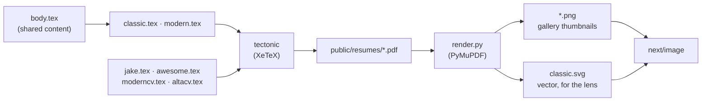

Rebuild everything with `frontend/resumes/build.sh` (needs `brew install tectonic` and `uv`). Third-party classes keep their licences: AltaCV ships unmodified; `rayume-awesome-cv.cls` is a renamed, modified copy of Awesome CV, as the LPPL requires.

---

## How it is built

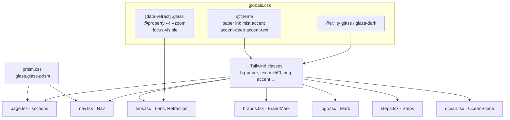

- **Tailwind first.** Plain CSS is only for what Tailwind can't express: the glass utilities, the Chromium refraction rule and the registered `@property` values the lens animates. CSS that belongs to one component sits next to it (`prism.css`, `templates/pdf.css`).
- **Server by default.** Client components only where there is state or effects: `nav.tsx` (scroll), `lens.tsx` (pointer), `steps.tsx` (in-view trigger), `ocean.tsx` (pause off screen and for reduced motion), `hero-phone.tsx` (the phone story's timeline).
- New pages reuse the tokens, the `glass` utilities and the component class strings above; they don't add new colours, fonts or radii.

---

## Do and don't

| Do | Don't |
|---|---|
| Use `bg-accent-deep` for buttons with white text | Put white text on `bg-accent` |
| Put glass over colour or moving content | Put glass on flat paper |
| Set headlines in one colour, Geist Serif, tight tracking | Colour or italicise one word for emphasis |
| Use real renders and real-sounding data | Use lorem ipsum or grey placeholder bars |
| Keep one star per section | Stack glows, glass and badges in the same spot |
| Let motion respond to the user or tell the story | Loop flashy animations for attention, or add ambient motion outside the ocean band |
| Start grids at `grid-cols-1` | Let a desktop grid overflow on phones |
| Build a phone version of a section that doesn't fit, and keep desktop as it is | Shrink a desktop composition until it technically fits |
| Fit the hero's title, pitch, visual and buttons on a phone's first screen | Push the buttons below the fold |
| Drop text on phones to make room | Make a table scroll sideways |
