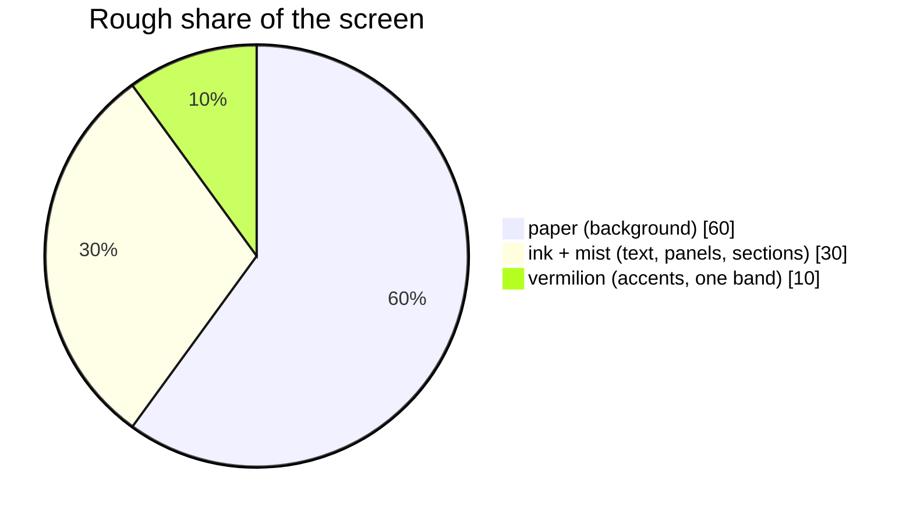
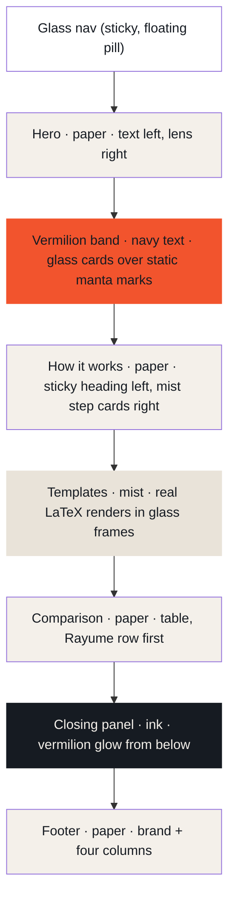
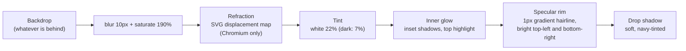
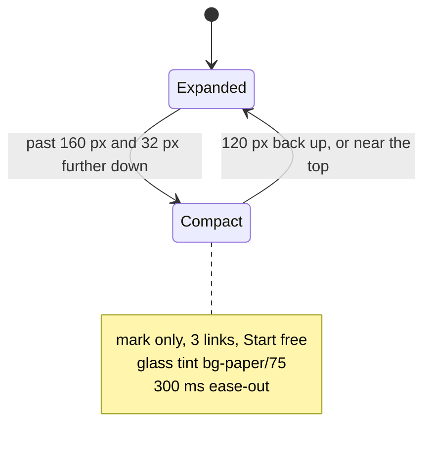
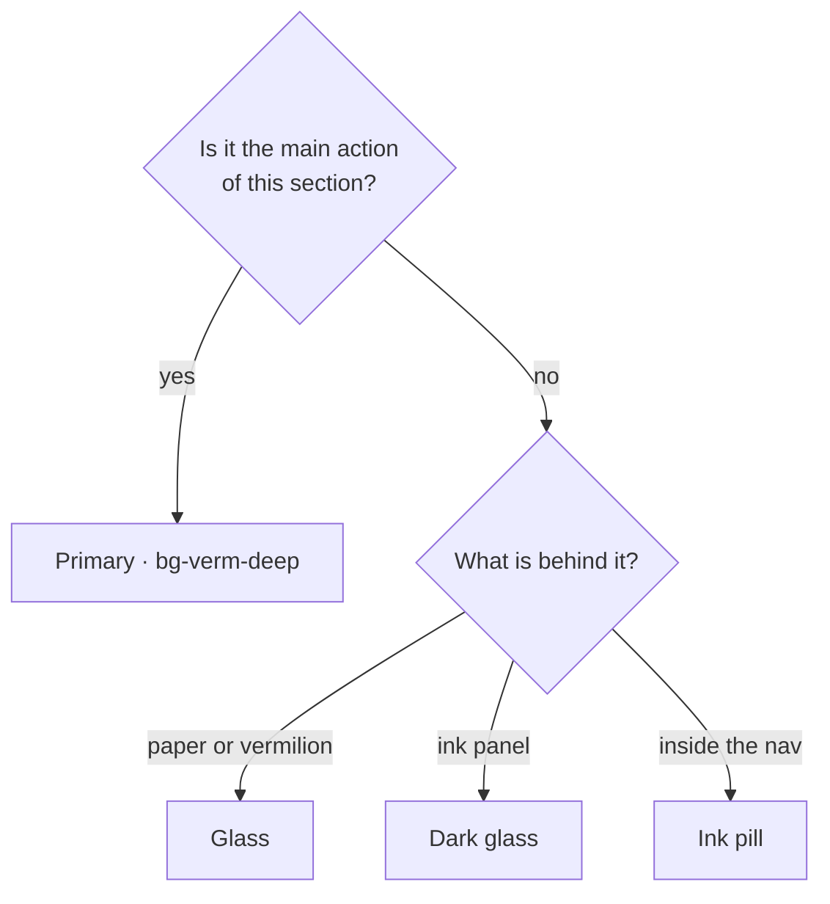
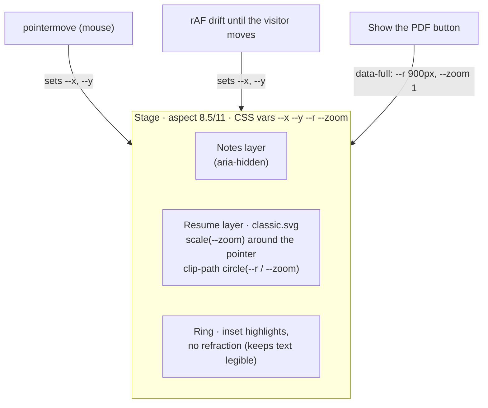
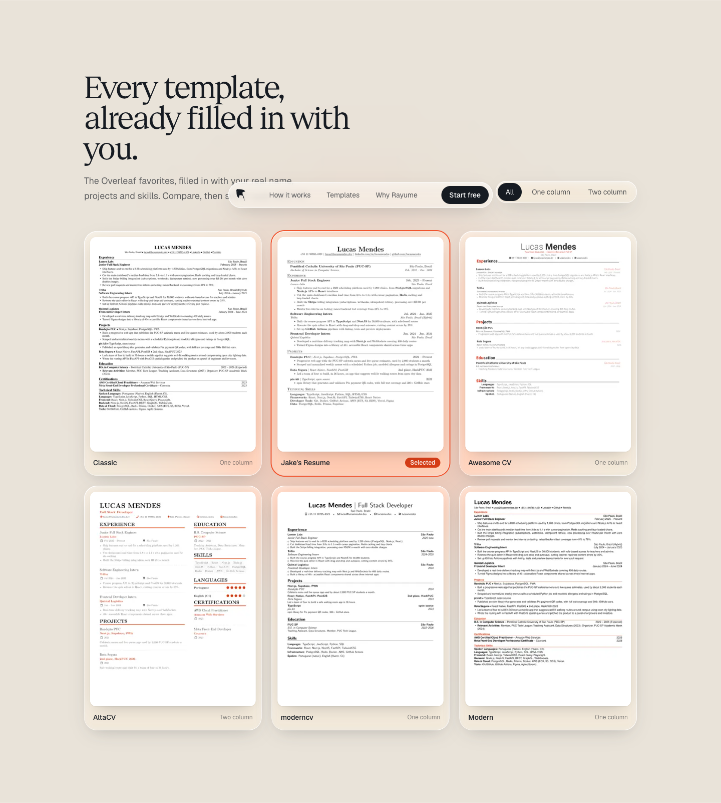
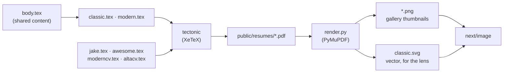
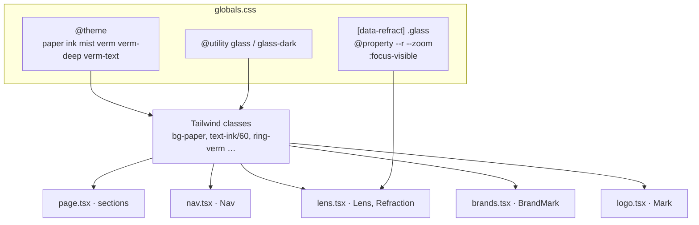

# Rayume Design System

> Status: **accepted**. This is the visual language for the whole site, taken from the shipped landing page (`frontend/app/`).
> Stack: Next.js 16, Tailwind CSS 4, Geist Sans + Geist Serif. Product context: [`../PROJECT.md`](../PROJECT.md).


**The idea in one line:** warm paper, navy ink and one loud vermilion, with Apple-style liquid glass where there is colour behind it to bend. Sophisticated enough to trust with your career, modern enough for a Gen Z job hunter.

## Contents

1. [Principles](#principles)
2. [Colour](#colour)
3. [Typography](#typography)
4. [Layout](#layout)
5. [Surfaces: liquid glass](#surfaces-liquid-glass)
6. [Shape and depth](#shape-and-depth)
7. [Components](#components)
8. [Motion](#motion)
9. [Voice and copy](#voice-and-copy)
10. [Accessibility](#accessibility)
11. [Assets](#assets)
12. [How it is built](#how-it-is-built)
13. [Do and don't](#do-and-dont)

---

## Principles

| | Principle | In practice |
|---|---|---|
| 1 | **Paper first** | The page is cream paper (`paper`). Navy (`ink`) does the talking. Vermilion is a highlighter, not a wallpaper, except in the one band built to show it off. |
| 2 | **One loud thing per screen** | Each section has a single star: the lens in the hero, the glass cards in the band, the PDF in the steps. Everything around it stays quiet. |
| 3 | **Glass needs something to bend** | Liquid glass only goes over colour or content (the nav while scrolling, cards on vermilion). Glass on flat cream is just a grey box. |
| 4 | **Show the real thing** | Resumes are real LaTeX renders of a real (fictional) person, never lorem ipsum or grey bars. |
| 5 | **Calm motion** | Motion answers the user (the lens follows the cursor, the nav reacts to scrolling). Nothing loops for attention. |
| 6 | **Accessible by default** | Every text pairing passes WCAG AA. Every effect has a reduced-motion fallback. |

---

## Colour


All colours are Tailwind theme tokens in `frontend/app/globals.css` (`@theme`). Use the token names, never raw hex: `bg-paper`, `text-ink`, `bg-mist`, `bg-verm`, `bg-verm-deep`, `text-verm-text`. Opacity modifiers work as usual (`text-ink/60`, `bg-verm/15`).

| Token | Hex | Use it for | Never use it for |
|---|---|---|---|
| `paper` | `#F4F0EA` | Page background, light text on `ink` | Cards on paper (no contrast) |
| `ink` | `#161B22` | All body text, headings, dark panels, ticks, secondary buttons | Large decorative fields |
| `mist` | `#E9E3D9` | Alternate sections (templates), step cards | Text |
| `verm` | `#F2542D` | The vermilion band, glows, the lens, large numerals, outlines | Small text, white text on top (3.4:1 fails) |
| `verm-deep` | `#D63C16` | Primary buttons, badges, accent ticks, anything with **white text on it** | Large areas (looks muddy) |
| `verm-text` | `#B8330F` | Small accent text on paper (labels, skill names), focus rings | Backgrounds |

### Why three vermilions

Pure vermilion is the brand, but it is too light for small text and too light under white text. The two deeper shades exist purely for contrast:

| Pair | Ratio | Passes AA for |
|---|---|---|
| `ink` on `paper` | 15.2 : 1 | All text |
| `ink` on `mist` | 13.6 : 1 | All text |
| `ink` on `verm` | 5.0 : 1 | All text (that is why the vermilion band uses navy text) |
| white on `verm-deep` | 4.7 : 1 | All text (buttons) |
| `verm-text` on `paper` | 5.3 : 1 | All text |
| white on `verm` | 3.4 : 1 | Large text only, avoid |
| `verm` on `paper` | 3.0 : 1 | Large text only (headline numerals) |

### Proportions



---

## Typography

Two families from Vercel's [Geist](https://vercel.com/font), installed from the `geist` npm package (Geist Serif is not on Google Fonts yet):

| Role | Family | Import | Where |
|---|---|---|---|
| Display | **Geist Serif Regular** | `import { GeistSerifRegular } from "geist/font/serif/regular"` | `h1`, `h2`, the wordmark, large numerals, the glass card quotes |
| Text | **Geist Sans** | `next/font/google` in `layout.tsx`, exposed as `font-sans` | Everything else |

Geist Serif ships one weight (400) and no italic. Emphasis comes from **size and colour, never from fake bold or slanted text**.

### Scale

| Name | Class | Size | Line height | Tracking |
|---|---|---|---|---|
| Display (hero `h1`) | `text-[clamp(3.1rem,7.4vw,6.4rem)]` | 50 to 102 px | `leading-[0.94]` | `-0.035em` |
| Section (`h2`) | `text-[clamp(2.4rem,4.6vw,3.8rem)]` | 38 to 61 px | `leading-[1]` | `-0.03em` |
| Closing (`h2` in the dark panel) | `text-[clamp(2.4rem,5.4vw,4.6rem)]` | 38 to 74 px | `leading-[1]` | `-0.03em` |
| Card quote | `text-[22px] sm:text-2xl` (serif) | 22 to 24 px | `leading-snug` | default |
| Lead | `text-[19px]` / `text-lg` | 18 to 19 px | `leading-[1.55]` | default |
| Body | `text-[15px]` | 15 px | `leading-relaxed` | default |
| Small | `text-sm` / `text-[13px]` | 13 to 14 px | default | default |

Rules:
- Headings are **sentence case**. No all-caps labels, no tracked-out eyebrows.
- Do **not** colour or italicise a single word in a headline. The headline is set in one colour.
- Keep lines under ~75 characters: `max-w-[34rem]` for lead paragraphs, `max-w-xl` for section intros.

---

## Layout



| Token | Value | Notes |
|---|---|---|
| Container | `mx-auto max-w-6xl` | 72 rem (1152 px) for every section |
| Gutter | `px-4 sm:px-6` | 16 px on phones, 24 px from `sm` |
| Section rhythm | `py-28 lg:py-36` | 112 px, 144 px on desktop |
| Hero grid | `lg:grid-cols-[1.08fr_0.92fr]` | Text slightly wider than the visual |
| Split sections | `lg:grid-cols-[0.8fr_1.2fr]` | Heading column + content column; the heading is `lg:sticky lg:top-28` |
| Card grids | `md:grid-cols-2`, `lg:grid-cols-3` | Grids always start at `grid-cols-1` so they shrink on phones |

Alignment is **left** everywhere except the closing panel, which is centred because it is a single call to action. Backgrounds alternate paper, vermilion, paper, mist, paper, ink, paper, so each section reads as its own sheet.

---

## Surfaces: liquid glass


Two Tailwind utilities, defined with `@utility` in `globals.css`:

```html
<div class="glass rounded-[28px] p-6">…</div>        <!-- light glass, on colour or content -->
<a class="glass glass-dark rounded-full …">…</a>   <!-- on dark panels -->
```

### Anatomy



- **Refraction** comes from `<Refraction />` in `lens.tsx`: it injects the SVG filter `#lg-refract` and sets `data-refract` on `<html>` in Chromium, where `backdrop-filter: url()` works. Safari and Firefox keep the plain blur instead of losing the backdrop.
- **Readability over busy colour:** when glass carries text over vermilion or ink (the compact nav), raise the tint: `bg-paper/75!`.

| Use glass | Don't use glass |
|---|---|
| The nav (content scrolls under it) | Cards on flat paper (use `bg-mist` or white) |
| Cards and chips on the vermilion band | Body text containers on paper |
| Frames around real content (the lens bezel, gallery cards) | Stacked glass on glass |
| Secondary buttons over colour (`glass glass-dark` on ink) | Anything that needs to be read at small size over a busy image |

---

## Shape and depth


- **Everything interactive is a pill** (`rounded-full`): buttons, chips, filter tabs, the nav.
- Radius grows with size: thumbnails `rounded-xl`, inner panels `rounded-2xl`, cards `rounded-[26px]`/`rounded-[28px]`, big frames `rounded-[34px]`/`rounded-[36px]`.
- **Shadows are tinted, never grey.** Navy shadows for objects on paper (`shadow-[0_12px_32px_-16px_rgb(22_27_34/0.3)]`), vermilion glow for the primary button and the highlighted table row (`shadow-[0_8px_24px_-8px_rgb(242_84_45/0.7)]`).
- Big soft colour glows (`bg-verm/25 blur-[120px]`) sit behind the hero visual, the gallery and the closing panel so the glass has colour to pick up.

---

## Components

All live in `frontend/app/`. Copy the class strings; they are the spec.

### Nav (`nav.tsx`)

| Expanded (top of page) | Compact (scrolling down) |
|---|---|
|  |  |



The hysteresis (32 px down, 120 px up) is deliberate: small trackpad flicks never toggle it.

### Buttons


| Variant | When | Classes |
|---|---|---|
| **Primary** | The one action per section ("Build my resume") | `btn` + `bg-verm-deep text-white shadow-[0_8px_24px_-8px_rgb(242_84_45/0.7),inset_0_1px_0_rgb(255_255_255/0.25)] hover:bg-[#E5471F]` |
| **Glass** | Secondary action on paper or colour | `glass` + `btn` + `text-ink hover:bg-white/40` |
| **Dark glass** | Secondary action on `ink` | `glass glass-dark` + `btn` + `text-white hover:bg-white/15` |
| **Ink** | Compact actions in chrome ("Start free" in the nav) | `rounded-full bg-ink px-4 py-2 font-medium text-white hover:bg-ink/85` |

Base: `btn = "inline-flex items-center justify-center rounded-full px-6 py-3.5 text-[15px] font-medium transition active:scale-[0.97]"`. Labels are verbs that say what happens. No arrows appended.



### Cards


| Card | Classes | Use |
|---|---|---|
| **Step card** | `rounded-[28px] bg-mist p-5 sm:p-6` | Numbered sequences on paper. Numeral in Geist Serif `text-3xl text-verm`, inline with the title. |
| **Glass card** | `glass rounded-[28px] p-6 sm:p-7` | On the vermilion band. Serif quote, navy chips. |
| **Demo panel** | `rounded-2xl bg-white p-4 shadow-[0_1px_2px_rgb(22_27_34/0.08)]` | Small fake UI inside a card (chat, job post, PDF row). |
| **Gallery card** | `glass rounded-[26px] p-3` + `ring-2 ring-verm` when selected | Frames a resume thumbnail. |

Numbering (1, 2, 3) is only for real sequences.

### Chips and badges

- Skill chip on vermilion: `rounded-full bg-ink px-3 py-1 text-[13px] font-medium text-white`
- Keyword highlight in text: `<mark class="rounded bg-verm/15 px-1 text-verm-text">`
- Status badge ("Selected", "New"): `rounded-full bg-verm-deep px-2.5 py-0.5 text-xs text-white`
- Filter tabs: a `glass rounded-full p-1` track; active tab `bg-ink text-white`, others `text-ink/70 hover:bg-white/50`

### Hero lens (`lens.tsx`)


The signature piece: rough notes underneath, the real compiled resume (a vector SVG, so it stays sharp at 2x) inside a magnifying ring.



### Template gallery



Every thumbnail is a real compile of the same person (see [Assets](#assets)): the team's template plus Jake's Resume, Awesome CV, AltaCV and moderncv from Overleaf.

### Comparison table


- Rayume row first, outlined in `border-verm` on its cells (rows can't take a radius), accent ticks `bg-verm-deep`, same height as the rest.
- Competitor logos at `size-4 text-ink/70` (`brands.tsx`, Simple Icons, CC0).
- Fixed columns: `table-fixed` with a `<colgroup>`, so headers sit over their ticks.
- Ticks: yes = filled `ink` circle, partly = `ink/10` circle with `~`, no = a faint dash. Each has an `sr-only` label.

### Footer


Brand column (mark, wordmark, tagline) plus four columns. Entries are plain text until their pages exist.

---

## Motion

| Moment | What moves | Timing | Reduced motion |
|---|---|---|---|
| Lens drift | Lens wanders over the page until the visitor moves the mouse | `requestAnimationFrame`, slow sine path | Static |
| Lens toggle | Radius and zoom open to the full page | 700 ms `cubic-bezier(0.2,0.8,0.2,1)` | Instant |
| Nav compact | Width, wordmark and "Sign in" collapse | 300 ms `ease-out` | Instant (no transition needed) |
| Buttons | Press shrinks to 97% | `active:scale-[0.97]` | Kept (it is feedback) |

Rules: one orchestrated moment per page (the lens). No entrance animations on scroll, no looping decoration. The manta marks in the band are **static** on purpose.

---

## Voice and copy

Written for an English-speaking Gen Z developer hunting their first tech job.

- **Plain and direct.** "Build my resume", not "Get started on your journey".
- **A little sassy about the competition, never about the user.** "Exports like a ransom note."
- **Specific numbers beat adjectives.** "Used by 2,000 students a month."
- Sentence case everywhere. No exclamation marks in UI. No middots joining metadata, no "→" on buttons.
- The tagline stays as written in the banner: *Your day to day tool to jobhunt.*

---

## Accessibility

- Contrast: every pairing in [Colour](#colour) is AA; don't introduce new ones without checking.
- Focus: a global `:focus-visible` ring, 2 px `verm-text`, offset 3 px (`globals.css`, `@layer base`).
- Motion: everything animated checks `prefers-reduced-motion`.
- Semantics: landmarks (`header`, `nav`, `section` with `aria-labelledby`, `footer`), table headers with `scope`, decorative SVGs `aria-hidden`.
- The lens content is reachable without a mouse: the "Show the PDF" toggle (`aria-pressed`) reveals the whole page, and the image has a full `alt`.
- Overscroll: `html` and `body` are `paper`, so macOS rubber-banding never flashes black.

---

## Assets

| Asset | Source | Notes |
|---|---|---|
| Manta mark | `logo.tsx` (`MARK_D`, `<Mark />`) | Traced from the README banner. Uses `currentColor`. Eyes are holes (`fill-rule: evenodd`). |
| Competitor marks | `brands.tsx` | Simple Icons (CC0). The Word tile is hand-drawn because Simple Icons dropped Microsoft marks. |
| Resumes | `frontend/resumes/` → `public/resumes/` | Lucas Mendes, a fictional full-stack dev. Companies are invented. |

### Resume pipeline



Rebuild everything with `frontend/resumes/build.sh` (needs `brew install tectonic` and `uv`). Third-party classes keep their licences: AltaCV ships unmodified; `rayume-awesome-cv.cls` is a renamed, modified copy of Awesome CV, as the LPPL requires.

---

## How it is built



- **Tailwind first.** Plain CSS is only for what Tailwind can't express: the glass utilities, the Chromium refraction rule and the registered `@property` values the lens animates.
- **Server by default.** Only `nav.tsx` and `lens.tsx` are client components (scroll and pointer state).
- New pages reuse the tokens, the `glass` utilities and the component class strings above; they don't add new colours, fonts or radii.

---

## Do and don't

| Do | Don't |
|---|---|
| Use `bg-verm-deep` for buttons with white text | Put white text on `bg-verm` |
| Put glass over colour or moving content | Put glass on flat paper |
| Set headlines in one colour, Geist Serif, tight tracking | Colour or italicise one word for emphasis |
| Use real renders and real-sounding data | Use lorem ipsum or grey placeholder bars |
| Keep one star per section | Stack glows, glass and badges in the same spot |
| Let motion respond to the user | Loop animations for attention |
| Start grids at `grid-cols-1` | Let a desktop grid overflow on phones |
