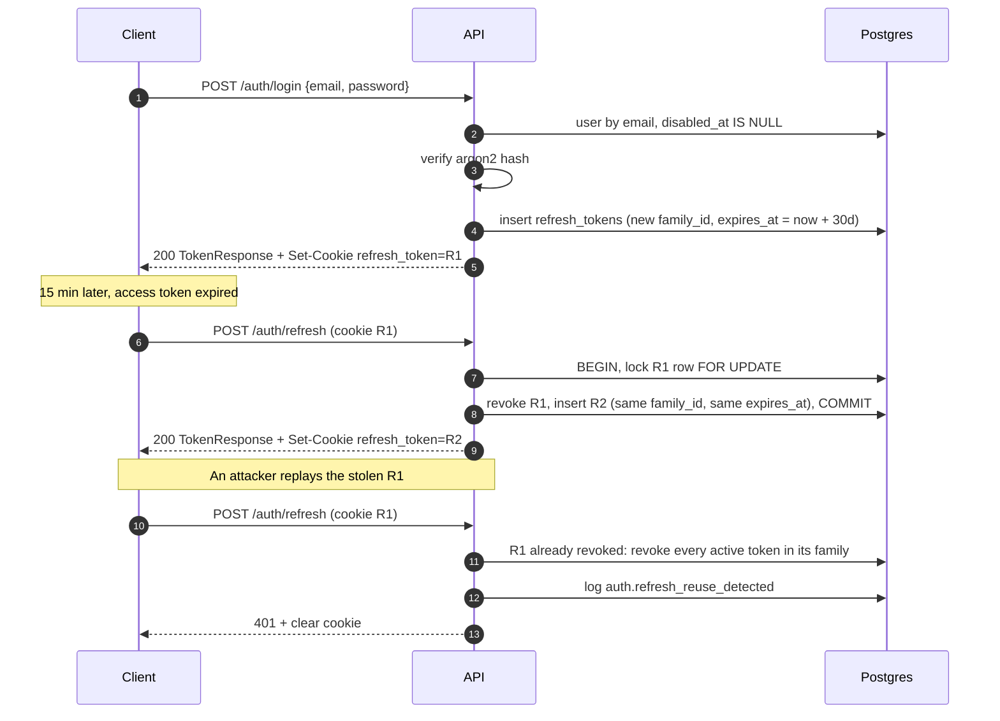
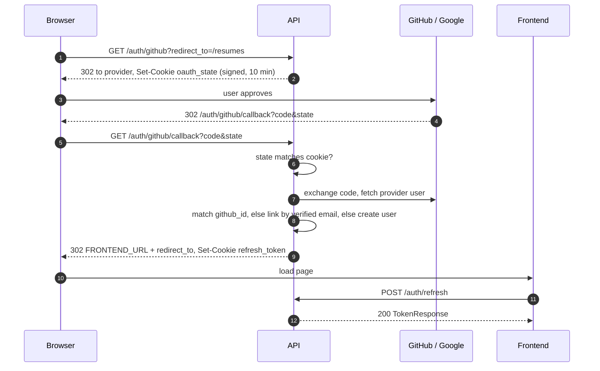

# Auth

In-house JWT, as specified in [`../database/README.md#auth-in-house-jwt`](../database/README.md#auth-in-house-jwt). This file only adds the HTTP surface.

## Tokens on the wire

- **Access token**: returned in the response body, sent back as `Authorization: Bearer <jwt>`. About 15 minutes. Claims: `sub` (user `public_id`), `iss`, `aud`, `exp`, `iat`. The client keeps it in memory only.
- **Refresh token**: set as a cookie, never in a body:
  `refresh_token=<random>; HttpOnly; Secure; SameSite=Lax; Path=/auth; Max-Age=<seconds until family expires>`
  `Path=/auth` keeps it off every other request. The browser extension sends it with `credentials: "include"` (needs host permission for the API).

`TokenResponse`, returned by register, login, refresh and used by the OAuth flow:

```json
{
  "access_token": "eyJhbGciOi...",
  "token_type": "bearer",
  "expires_in": 900,
  "user": { "...": "User object, see users.md" }
}
```

## Login and refresh



### POST /auth/register

Email signup. Creates the user and logs them in.

| Body field | Type | Rules |
|------------|------|-------|
| `email` | string | required, valid email, stored lowercased |
| `password` | string | required, 8 to 128 chars |
| `username` | string | required, 3 to 30 chars, `^[a-z0-9_-]+$`, not reserved; lowercased |
| `name` | string | required, 1 to 100 chars |
| `language` | string | optional, `en` (default) or `pt-BR` |

Responses:
- `201` `TokenResponse` + refresh cookie. Logs `auth.login`.
- `409` email or username taken (`{"detail": "email_taken"}` / `"username_taken"`). A disabled account still holds its email.
- `422` validation.
- `429` rate limited.

### POST /auth/login

| Body field | Type | Rules |
|------------|------|-------|
| `email` | string | required |
| `password` | string | required |

Responses:
- `200` `TokenResponse` + refresh cookie. Starts a new token family. Logs `auth.login`.
- `401` `{"detail": "invalid_credentials"}` for an unknown email, wrong password, OAuth-only account (no `password_hash`) **or** a disabled user. One message for all, so emails can't be enumerated. Logs `auth.login_failed` (with `user_id` null when the email is unknown).
- `429` rate limited.

### POST /auth/refresh

No body. Reads the `refresh_token` cookie.

Responses:
- `200` `TokenResponse` + rotated refresh cookie. The new row keeps the family's `expires_at`.
- `401` cookie missing, unknown, expired, or user disabled. Clears the cookie.
- `401` cookie already revoked: **reuse detected**, the whole family is revoked. Clears the cookie.

### POST /auth/logout

No body, no bearer token needed (it works even after the access token expired). Reads the `refresh_token` cookie.

- `204` always. If the cookie matches a token, its family gets `revoked_at = now()` and `auth.logout` is logged. The cookie is cleared.
- Other devices (other families) stay logged in. The access token in hand stays valid until its `exp`; the client drops it.

## OAuth (GitHub, Google)



### GET /auth/{provider}

| Param | In | Type | Rules |
|-------|----|------|-------|
| `provider` | path | string | `github` or `google`, else 404 |
| `redirect_to` | query | string | optional frontend path to land on, must start with `/` (no open redirects); default `/` |

- `302` to the provider's authorize URL with a random `state`. The `state` and `redirect_to` are kept in a short-lived signed `oauth_state` cookie.

### GET /auth/{provider}/callback

Called by the provider, not by our code.

| Param | In | Type | Rules |
|-------|----|------|-------|
| `provider` | path | string | `github` or `google` |
| `code` | query | string | from the provider |
| `state` | query | string | must equal the `oauth_state` cookie |
| `error` | query | string | set by the provider when the user cancels |

Account resolution, in order:
1. A user with this `github_id` / `google_id` exists: log them in.
2. A user with the provider's **verified** email exists: set the provider id on it, log in.
3. Otherwise create a user: `username` suggested from the GitHub login or the email's local part (number appended on collision), `name` and `picture_url` from the provider, `password_hash` null.

Responses:
- `302` to `{FRONTEND_URL}{redirect_to}` with the refresh cookie set. The frontend then calls `POST /auth/refresh` to get an access token.
- `302` to `{FRONTEND_URL}/login?error=<code>` on bad `state`, provider error, cancelled login, or a disabled user (`error=oauth_failed`; logs `auth.login_failed`).
